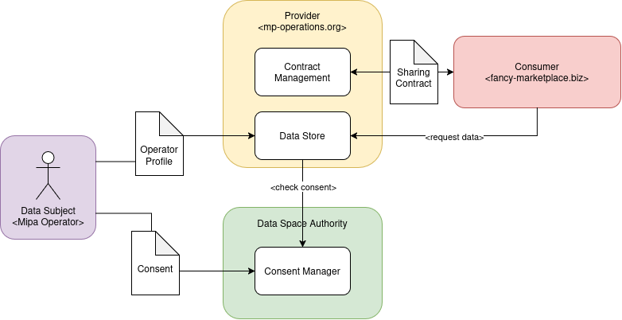
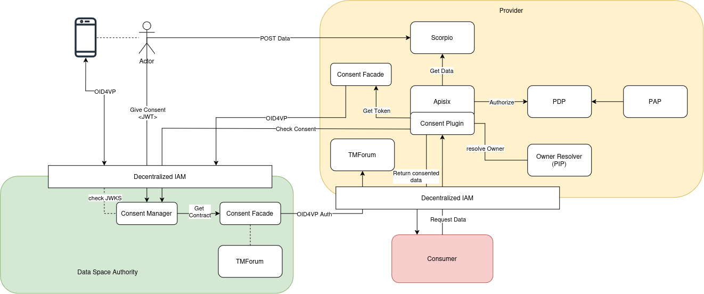
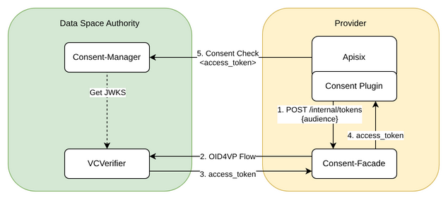
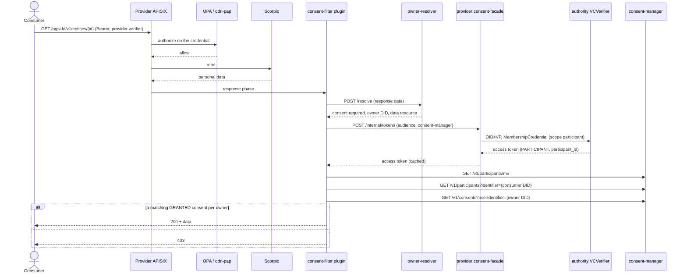

# Consent Management

Some data spaces require that access to personal data is backed by the **explicit consent** of the
data subject, recorded in an auditable way. The Data Space Connector can deploy an optional
consent-management layer built on [dsc-consent-manager](https://github.com/SEAMWARE/dsc-consent-manager)
(Java, PostgreSQL), which records consents against privacy notices, signs
[ISO/IEC TS 27560](https://www.iso.org/standard/80392.html)-style consent receipts, and has the
consent enforced at the provider's gateway on top of the existing ODRL/OPA authorization.

The decisions behind this integration are recorded as [ADRs](adr/README.md); the current design is
[ADR 0008](adr/0008-dsc-consent-manager.md), which supersedes ADRs 0001-0005 (the OID4VP integration
of the former Prometheus-X consent-manager). Upgrading from that setup is covered in
[Migrating from the Prometheus-X consent-manager](#migrating-from-the-prometheus-x-consent-manager).

## The use case

Sharing personal data between organizations extends what a data space can do, but it has to comply
with regulations like the [General Data Protection Regulation - GDPR](https://gdpr-info.eu/) and
standards like [ISO/IEC TS 27560](https://www.iso.org/standard/80392.html) for recording the consent
of the data subject. In the example use case, `mp-operations.org` stores the educational history of
its registered operators, so that consumers can see the level of service to expect. Parts of that
data are personal and belong to the operator. They may only be shared with another organization (for
example the consumer `fancy-marketplace.biz`) when the data subject explicitly consents. Consent
management covers that:

* Data subjects are first-class citizens of the data space: they are identified by their DID across
  all participants, and grant or revoke consent on data and on the contracts between organizations
  themselves.
* An authority (the `Data Space Authority`) keeps the consents, independently of data holders and
  consumers.
* Data providers check consent on every interaction involving personal data.
* Consent decisions and data access are logged and traceable.



A concrete interaction:

* The data subject "Mipa Operator" provides its "OperatorProfile" to `mp-operations.org`.
* `mp-operations.org` and `fancy-marketplace.biz` agree on a contract giving `fancy-marketplace.biz`
  access to "OperatorProfile" entries.
* The consent-manager derives a privacy notice from that contract, and "Mipa Operator" grants
  consent to it at the authority.
* `fancy-marketplace.biz` requests the profile at `mp-operations.org`, which checks the consent at
  the consent-manager and answers accordingly.

## Architecture

Consent management spans the **authority** (the trust-anchor namespace, which knows all participants)
and the **provider** that serves the personal data. In production the consent-manager is operated by
such a central authority in its own environment.



### Components

**Authority** (namespace `trust-anchor`), deployed as **two releases** split along the chart boundary:

* the **`trust-anchor` release** ([`charts/trust-anchor`](../charts/trust-anchor)) carries the consent
  **data plane**: the consent-manager, the authority consent-facade, the setup Job and the
  NetworkPolicies, on the chart's Zalando `managedPostgres`. The k3s scenario turns it on with
  [`k3s/consent-trust-anchor-components.yaml`](../k3s/consent-trust-anchor-components.yaml);
* the **`consent-authority` release** ([`charts/data-space-connector`](../charts/data-space-connector),
  via [`k3s/consent-trust-anchor.yaml`](../k3s/consent-trust-anchor.yaml)) carries the **IAM** that
  backs consent: the keycloak issuer, the VCVerifier with its `consent-manager` service, the
  `did:web:dataspace-authority.org` helper, the vc-operator, and an APISIX gateway that publishes
  `consent-manager.dataspace-authority.org`.

The releases share the namespace and address each other by fixed names (`consent-manager`,
`consent-facade`, the `dataspace-authority.org-tls` and `vc-operator-credential` secrets), so no
values are plumbed across releases.

* **consent-manager** - [dsc-consent-manager](https://github.com/SEAMWARE/dsc-consent-manager), a
  stateless OAuth2 resource server. It validates the authority verifier's JWT on every call, keeps
  participants, data subjects, privacy notices and consents in its own `consent_manager` PostgreSQL
  database, and signs consent receipts. API on port `8080` under `/v1`; health and metrics on the
  management port `9090`, which no NetworkPolicy admits.
* **authority consent-facade** - [consent-facade](https://github.com/SEAMWARE/consent-facade) projects
  the providers' TM Forum data (agreements, catalog, organizations) into the contract-service API the
  consent-manager derives privacy notices from (`consent-manager.config.contractServiceUrl`). It also
  serves the public participant and catalog self-descriptions under
  `https://consent-facade.dataspace-authority.org`. It authenticates its TM Forum reads to each
  provider over OID4VP as `did:web:dataspace-authority.org`.
* **authority gateway** - publishes `/v1/*` and `/.well-known/jwks.json` of the consent-manager. It
  neither authenticates nor injects anything: the consent-manager checks every token itself.

**Provider** (the [`k3s/consent-provider.yaml`](../k3s/consent-provider.yaml) overlay on
[`k3s/provider.yaml`](../k3s/provider.yaml)):

* **consent-filter plugin** - an external APISIX plugin
  ([consent-plugin](https://github.com/SEAMWARE/consent-plugin), image
  `quay.io/seamware/consent-plugin:1.0.0`) on the `mp-data-service-consent` route. It is the only
  consent-enforcement path: OPA authorizes the request on the presented credential, then the plugin
  gates the response on the data subjects' consent.
* **consent-owner-resolver** - [consent-owner-resolver](https://github.com/SEAMWARE/consent-owner-resolver)
  tells the plugin, from the response data, whether consent is required and who owns the data. It is
  provider-side because the answer depends on the provider's data model.
* **provider consent-facade** - a second, provider-local instance. It is the plugin's **token service**
  (`POST /internal/tokens`: it presents the provider's MembershipCredential to the authority verifier)
  and serves the provider's own contracts to the owner-resolver. It is never published.

### Where the components come from

| component | chart | version | pulled by |
|---|---|---|---|
| consent-manager | `oci://quay.io/fiware/helm-charts/dsc-consent-manager` (alias `consent-manager`) | 0.1.0 | `charts/trust-anchor` |
| consent-facade | `oci://quay.io/fiware/helm-charts/consent-facade` | 0.2.1 | `charts/trust-anchor` (authority) and `charts/data-space-connector` (provider) |
| consent-owner-resolver | `oci://quay.io/fiware/helm-charts/consent-owner-resolver` | 0.2.0 | `charts/data-space-connector` |

The consent-manager runs image **0.0.3**, which `charts/trust-anchor` pins with
`consent-manager.deployment.image.tag` because the chart's own `appVersion` is still 0.0.1. Three
fixes in it are what this deployment needs: the privacy notice is generated from the bilateral
endpoint when the contract service answers the ecosystem one with `501` (which the consent-facade
does); a client exempted from the global proxy with `proxy-type: DIRECT` no longer inherits the
proxy address it was exempted from; and a contract may name its parties by the participants'
self-description URLs. Remove the pin when the dependency moves to a chart whose `appVersion` is
0.0.3 or newer.

### How a contract names its parties

One agreement feeds two readers, and until 0.0.3 they disagreed on what identifies a party:

| reader | reads the parties from | identifies a party by |
| --- | --- | --- |
| consent-manager (privacy-notice generation) | the contract it fetches by `contractUri` | participant identifier **or** self-description URL (0.0.3+) |
| consent-facade `/verify` → owner-resolver → consent-plugin | the same contract, looked up for the pair | self-description URL |

The facade projects the agreement's `provider-id`/`consumer-id` characteristics verbatim into the
contract's `dataProvider`/`dataConsumer`, so those characteristics decide what both readers see.
They carry the **participants' self-description URLs** — the form `contract-management` writes
(`CONSENT_SELF_DESCRIPTION_BASE_URL`), and the only form `/verify` matches, since that lookup is
keyed by the self-description URLs the plugin reads off the consent-manager's participant records.
A consent-manager before 0.0.3 accepted only the participant identifier there, so an agreement
could satisfy notice generation or the access gate, never both: with DIDs every gated read was
denied (`no signed contract between …`), with URLs generation answered `404 No active participant
is registered under '<url>'`.

Notices, consents and receipts still record the participant **identifier** whichever name the
contract used, so nothing downstream of generation changes.

Each pins `fullnameOverride` (and `nameOverride` where a NetworkPolicy selects on the name label), so
resources are called `consent-manager`, `consent-facade` and `owner-resolver` in every release.

## Authentication and roles

Every caller - participant or data subject - presents an access token of the **authority VCVerifier**,
service `consent-manager`. The consent-manager trusts that verifier as its
`identityProviders.primary` and takes the caller's identity and role from the token's claims. There
is no shared secret anywhere on the consent path.



The verifier service selects the credential by **scope**; every token it issues carries
`aud: consent-manager`:

| scope | credential | who | issued by |
|---|---|---|---|
| `participant` | `MembershipCredential` | providers (through their consent-facade) and consumers | the participant's own keycloak, trusted because its issuer DID is in the trust-anchor TIR |
| `openid` (default) | `UserCredential` | data subjects | an issuer in the TIR |

### Claim and role contract

The verifier writes flat, top-level claims (`flatClaims: true`, `jwtInclusion.claimsToInclude`), and
`consent-manager.identityProviders.primary` reads them:

| claim | content | read as |
|---|---|---|
| `sub` | holder DID of the presentation | `claims.userIdentifier: [sub]` - the data subject's identifier |
| `participant_id` | the MembershipCredential's `issuer` (participant scope only) | `claims.participantIdentifier: [participant_id]` - the participant DID |
| `roles` | the credential's `type` array | `claims.roles: [roles]`, mapped by `roleMapping` |
| `email`, `given_name`, `family_name` | the UserCredential's profile (openid scope only) | profile data |

`roleMapping` turns the credential type into the consent-manager's role:

| credential type | role | grants |
|---|---|---|
| `MembershipCredential` | `PARTICIPANT` | register itself, link its data subjects, generate privacy notices, list / check / terminate consents it is a party to |
| `UserCredential` | `USER` | register itself, grant / refuse / revoke its own consents, read its consents and receipts, erase its record |
| `consent-catalog` (chart default) | `CATALOG` | not granted: no credential carries it |

Neither credential carries a role claim of its own. The verifier already enforces the credential
type per scope and checks the issuer against the TIR, so no participant can issue itself a consent
role. `participant_id` is the credential's `issuer`, the DID the TIR check covers, and not
`credentialSubject.id`, which any issuer sets freely. Both DCQL queries ask for a single credential
(`multiple: false`), because with several matching credentials the verifier lets the last one's claims
win. That is only a wallet hint, which the verifier does not enforce (see
[Known limitations](#known-limitations)).

The relevant settings, from [`k3s/consent-trust-anchor-components.yaml`](../k3s/consent-trust-anchor-components.yaml):

```yaml
consent-manager:
  identityProviders:
    primary:
      # the verifier's bare server.host; compared byte-for-byte with the discovery `issuer`
      issuer: https://verifier.dataspace-authority.org
      # the verifier serves discovery only under the per-service path
      discoveryUrl: https://verifier.dataspace-authority.org/services/consent-manager/.well-known/openid-configuration
      audience: consent-manager
      claims:
        userIdentifier: [sub]
        participantIdentifier: [participant_id]
        roles: [roles]
      roleMapping:
        user: UserCredential
        participant: MembershipCredential
        catalog: consent-catalog
```

The verifier side is the `consent-manager` entry under
`decentralizedIam.vcAuthentication.vcverifier.registration.services` in
[`k3s/consent-trust-anchor.yaml`](../k3s/consent-trust-anchor.yaml).

### The provider's token service

The plugin holds no credential. It asks its provider-local consent-facade for a token, which the
facade obtains by presenting the provider's MembershipCredential to the authority verifier:

```
POST /internal/tokens
Content-Type: application/json

  { "audience": "consent-manager" }

200 OK
  { "access_token": "eyJ...", "token_type": "Bearer", "expires_in": 3540 }
```

* `audience` is a configured name (`consent-facade.oid4vp.tokenTargets[].audience`), never a URL, so
  nothing in the namespace can make the facade present the credential to an arbitrary host. An
  unknown audience answers `400`.
* Tokens are cached per audience until shortly before expiry.
* Errors tell "retry later" from "will never work": `502` verifier unreachable, `403` credential
  refused, `400` unknown audience, `500` broken OID4VP setup of the facade itself.
* `/internal/**` is never published. The provider facade's ingress is off and its NetworkPolicy
  admits only the APISIX pods and the owner-resolver.

The endpoint is specified in
[api/consent-facade-internal.yaml](https://github.com/SEAMWARE/consent-facade/blob/main/api/consent-facade-internal.yaml).

### Known limitations

* **The provider's MembershipCredential is not holder-bound.** `k3s/provider.yaml` issues it with
  `holderBinding.enabled: false`, so it carries no confirmation claim and anyone holding the JWT can
  replay it. Enabling holder binding is the hardening step.
* **The issuer of a `jwt_vc_json` credential is not cross-checked.** VCVerifier 6.27.0 does not compare
  `vc.issuer` with the signed `iss`, so a hand-crafted credential can still name another DID as its
  issuer until upstream rejects the mismatch (it already does on the `vc+jwt` path).
* **An agreement that names its parties by DID gates nothing, silently.** Since 0.0.3 the
  consent-manager resolves a contract party under either name, but the consent-facade's `/verify` -
  the lookup the owner-resolver makes to find the governing contract - matches only the
  participants' self-description URLs. An agreement whose `provider-id` / `consumer-id` carry the
  DIDs therefore generates a privacy notice and accepts a consent, while every gated read stays
  denied: the owner-resolver answers `422` ("contract matcher"), the plugin `403`. Write the
  self-description URLs, as `contract-management` and the
  [walkthrough](#walkthrough-on-the-local-k3s-scenario) do; see
  [How a contract names its parties](#how-a-contract-names-its-parties).
* **`multiple: false` is not enforced.** The DCQL queries ask for one credential, but VCVerifier 6.27.0
  accepts a presentation with several matching ones and takes `participant_id` and `roles` from the
  last. A wallet holding two matching credentials decides which identity the token carries.
* **A missing processing purpose degrades silently**, see
  [Declaring the processing purpose](#declaring-the-processing-purpose).
* **In-cluster transport is plain HTTP.** The plugin calls
  `consent-manager.trust-anchor.svc.cluster.local:8080` without TLS. The bearer is a short-lived,
  audience-bound token, not a long-lived secret.

## The `/v1` API

The consent-manager's API is specified in
[api/openapi.yaml](https://github.com/SEAMWARE/dsc-consent-manager/blob/main/api/openapi.yaml). In the
k3s scenario it is published as `https://consent-manager.dataspace-authority.org/v1`. The calls the
connector relies on, by role:

| step | call | role | notes |
|---|---|---|---|
| register a participant | `POST /v1/participants` `{legalName, email, selfDescriptionUri}` | PARTICIPANT | the identifier is the DID in the token, never the body; `409` when registered, update with `PUT /v1/participants/me` |
| read the own registration | `GET /v1/participants/me` | PARTICIPANT | `403` "not registered" until registered |
| look up a participant | `GET /v1/participants?identifier=<did>` or `GET /v1/participants/{identifier}` | any | |
| register a data subject | `POST /v1/users/register` (no body) | USER | the identifier is the token's `sub`; `201` first, `200` after |
| link a subject to the provider | `POST /v1/participants/me/users` `{identifier}` | PARTICIPANT | |
| generate a privacy notice | `POST /v1/privacy-notices/by-contract` `{contractUri}` | PARTICIPANT | `201` new, `200` when the contract is unchanged |
| read a privacy notice | `GET /v1/privacy-notices/{id}` | any | `resolve=true` (default) dereferences contract, catalog and recipients |
| grant or refuse | `POST /v1/consents` `{privacyNoticeId, decision}` | USER | `decision: GRANTED`; optional `purposes` / `data` elect a subset |
| ask a subject to decide | `POST /v1/consents/requests` | PARTICIPANT | |
| list | `GET /v1/consents?userIdentifier=&privacyNoticeId=&status=` | PARTICIPANT | only consents the caller is a party to; `GRANTED` unless `status` says otherwise |
| list the own consents | `GET /v1/consents/me` | USER | |
| check | `GET /v1/consents/check?userIdentifier=&privacyNoticeId=[&purpose=]` | PARTICIPANT | `{"valid": true}` only for a `GRANTED` consent whose scope covers the request |
| revoke | `POST /v1/consents/{id}/revoke` | USER | also `refuse`, `re-confirm`, `resume` |
| terminate | `POST /v1/consents/{id}/terminate` | PARTICIPANT | a party ends the consent |
| receipt | `GET /v1/consents/{id}?format=receipt` or `GET /v1/consents/me/{id}?format=receipt` | PARTICIPANT / USER | `format=receipt` (ISO/IEC 29184) or `receipt-kantara`; answered as `{receipt, jws}` |
| verify a receipt | `GET /.well-known/jwks.json` | public | at the origin root, not under `/v1` |
| erase the own record | `DELETE /v1/users/me` | USER | |

### Participants and data subjects

A participant registers itself with its MembershipCredential token and points `selfDescriptionUri` at
its self-description. In the scenario that is the authority consent-facade's
`https://consent-facade.dataspace-authority.org/participants/<tmforum-organization-id>`, projected from
the TM Forum organization that carries the participant's DID as the `did` party characteristic.
Both sides of a consent must be registered: the plugin denies when the provider is not found at
`/participants/me` or the consumer DID is unknown or has no `selfDescriptionUri`.

A data subject registers itself with its UserCredential token; its identifier is the holder DID. The
provider then links the subject to itself (`POST /v1/participants/me/users`), as it registers its data
subjects.

### Privacy notices

A privacy notice is derived from a contract served by the contract service
(`consent-manager.config.contractServiceUrl`, the authority consent-facade). A contract URI is that
base plus the bilateral contract the facade projects from a TM Forum agreement:

```
http://consent-facade.trust-anchor.svc.cluster.local:8080/bilaterals/default~<agreement-id>
```

The agreement's `provider-id` and `consumer-id` characteristics must hold the participants'
self-description URLs (see
[How a contract names its parties](#how-a-contract-names-its-parties)). The notice's purposes come
from the product specification, its data resources from the catalog.

`GET /v1/privacy-notices/{id}` resolves by default (`resolve=true`). Resolution never fails the request:
whatever could not be read is marked `UNAVAILABLE`. `resolve=false` makes no external request.

### Declaring the processing purpose

A consent is consent *for a purpose*. Everything else is derived by the connector - participants from
registration, contract and data resources from the TM Forum agreement - but the processing purpose is
a legal declaration of the provider and cannot be derived. Declare it on the **product specification**
as a characteristic **named `purpose`**:

```json
{
  "name": "Operator Profile",
  "productSpecCharacteristic": [
    {
      "name": "purpose",
      "valueType": "object",
      "productSpecCharacteristicValue": [
        {
          "value": {
            "id": "profile-service-provision",
            "name": "Operator profile for service provision",
            "description": "Deliver the requested service.",
            "purpose": "https://w3id.org/dpv#ServiceProvision"
          }
        }
      ]
    }
  ]
}
```

* The characteristic is matched on its `name` (`purpose`, configurable as the facade's
  `spec.purposeCharacteristic`), unlike the ODRL policy, which contract-management matches on
  `valueType`.
* The value may be an object (as above), a JSON string, or a plain string, which is taken as the
  purpose name. `name` and `description` become the notice's purpose; a DPV URI in `purpose`
  documents it machine-readably.

> :warning: **A missing purpose degrades silently.** Without the characteristic the facade uses the
> product specification's `name` as the purpose, so the subject consents to a product name rather
> than a processing purpose, and nothing downstream notices. Check that a notice's purposes carry the
> value you declared. BAE's product UI has no field for it today, so BAE-created products need a
> specification template that carries one.

### Granting, checking and revoking

The data subject grants with its own token: `POST /v1/consents` with the notice id and
`"decision": "GRANTED"`. The response is the consent, with `status: GRANTED` and the contract's
`provider` and `consumer` DIDs. Without `purposes` / `data` the consent covers the whole notice. A new
decision on the same notice supersedes the previous one. The subject withdraws with
`POST /v1/consents/{id}/revoke`; a participant that is a party can end a consent with `terminate`.

Participants read consents through `GET /v1/consents` (scoped to consents they are a party to) and ask
`GET /v1/consents/check` whether one is in force right now.

### Receipts and the JWKS

Every decision can be read as a signed receipt: `format=receipt` (an ISO/IEC 29184 consent record) or
`format=receipt-kantara` (Kantara KI-CR-v1.1.0), answered as `{receipt, jws}`. The receipt is rendered
from the terms frozen when the decision was taken, so it reads the same after the notice is
regenerated. Anyone holding a receipt verifies its `jws` against the public key set at
`https://consent-manager.dataspace-authority.org/.well-known/jwks.json`, which lists the active key
first and then any retired keys. `consent-manager.config.receiptsJurisdiction` (default `EU`) is
stated in every receipt. Keys are covered in [Receipt signing key](#receipt-signing-key).

## Enforcement: the consent-filter plugin

The plugin runs on the provider's `mp-data-service-consent` route, in both external-plugin phases:
`ext-plugin-pre-req` captures the request, `ext-plugin-post-resp` decides. Gating on the response
lets the decision be made per data subject in the returned data, not only on the caller's token. Both
phases must carry the identical configuration, else the plugin finds no stored context and fails
closed.



### Route configuration

The route conf in [`k3s/provider.yaml`](../k3s/provider.yaml):

```json
{
  "consent_api_url": "http://consent-manager.trust-anchor.svc.cluster.local:8080",
  "consent_api_prefix": "/v1",
  "check_mode": "list",
  "owner_resolver_url": "http://owner-resolver.provider.svc.cluster.local:8080/resolve",
  "service": "mp-data-service",
  "token_service_url": "http://consent-facade.provider.svc.cluster.local:8080/internal/tokens",
  "token_audience": "consent-manager",
  "fail_open": false,
  "audit_enabled": false,
  "audit_otlp_endpoint": "http://provider-opentelemetry-collector:4318"
}
```

| option | default | meaning |
|---|---|---|
| `consent_api_url` | | base URL of the consent-manager |
| `consent_api_prefix` | `/v1` | API base path |
| `check_mode` | `list` | `list` reads the owner's consents and matches them in the plugin; `check` asks the consent-manager's validity check, which is keyed by a privacy notice |
| `owner_resolver_url` | | the owner-resolver's `/resolve` |
| `service` | | service name the owner-resolver rules match on |
| `token_service_url` | | the provider consent-facade's `/internal/tokens` |
| `token_audience` | `consent-manager` | audience asked for at the token service |
| `consumer_claim` | `verifiableCredential.issuer` | where the consumer DID is read from the consumer's (provider verifier) token |
| `privacy_notice_id` | | pin the route to one privacy notice |
| `purpose` | | pin the route to one purpose |
| `require_purpose` | `false` | deny unless the consent covers a named purpose |
| `require_contract` | `false` | deny unless the consent matches a named contract or privacy notice |
| `fail_open` | `false` | keep `false`: an unreachable consent-manager then denies |
| `audit_enabled`, `audit_otlp_endpoint` | off | see [Access audit log](#access-audit-log) |

`consent_api_host`, `consent_key` and the `CONSENT_KEY` environment variable are gone in 1.0.0; if
still set they only log a warning.

`require_purpose` and `require_contract` stay off in the scenario: owner-resolver 0.2.0 returns only
the owner and the data resource per claim, no purpose and no contract URI or notice id, so either
option would deny every request. `consumer_claim` stays at its default because the provider
verifier's `data-service` scope includes the full credential in the token.

### Matching rules

For each owner the owner-resolver reports, the plugin allows only when a consent of that owner has

* status `GRANTED`,
* `provider` = the provider DID, taken from `GET /v1/participants/me` with the provider's token,
* `consumer` = the consumer DID read from `consumer_claim`,
* and the `contractUri` / `privacyNoticeId` / purpose, when the owner-resolver or the route names them.

Before that, the consumer DID must be a registered participant with a `selfDescriptionUri`
(`GET /v1/participants?identifier=`), and the provider must be registered. Every other case is a
`403`.

What the plugin therefore relies on:

* the provider consent-facade's token carries the `PARTICIPANT` role and `participant_id`, i.e. the
  verifier claim contract [above](#claim-and-role-contract);
* both provider and consumer are registered at the consent-manager;
* the subject's consent names exactly that provider and consumer, i.e. the privacy notice comes from
  their contract.

### Access audit log

The plugin can record every access decision to the OpenTelemetry Collector, separate from traces.
With `audit_enabled: true` it emits one OTLP/HTTP log record per request to `audit_otlp_endpoint`
(`.../v1/logs`, also settable via `CONSENT_AUDIT_OTLP_ENDPOINT`), with resource
`service.name=consent-access-audit` and the attributes `event.domain=audit`, `consent.decision`,
`consent.reason`, `enduser.id`, `http.request.method`, `url.path` and `http.request.id`. Emission is
asynchronous and best-effort: it never changes the decision.

Deploy the Collector (`opentelemetry-collector.enabled: true`) and give it a logs pipeline to a
durable, append-only sink:

```yaml
service:
  pipelines:
    logs:
      receivers: [otlp]
      processors: [memory_limiter, batch]
      exporters: [file/audit]      # or opensearch/audit, kafka/audit, ...
```

Once other logs are ingested too, split them with the `routing` connector on
`service.name == "consent-access-audit"`. Immutability and retention are the sink's job. The consent
record's own lifecycle lives in the consent-manager.

## Deployment

### trust-anchor chart (2.0.0)

Everything is off by default. The authority turns it on:

```yaml
consentManagement:
  enabled: true                  # NetworkPolicies
consent-manager:
  enabled: true                  # requires managedPostgres.enabled
  config:
    # written into receipts and e-mail links: the address a data subject can reach
    consentManagerUrl: https://consent-manager.<authority-domain>
    contractServiceUrl: http://consent-facade:8080   # chart default
  identityProviders:
    primary: {}                  # the verifier, see "Claim and role contract"
consent-facade:
  enabled: true
  # tmForum, selfUrl, ingress, oid4vp: see k3s/consent-trust-anchor-components.yaml
```

The chart presets what the setup Job and the subchart have to agree on. Leave these alone:

| value | preset |
|---|---|
| `managedPostgres.config.users.consent_manager`, `managedPostgres.config.databases.consent_manager` | the consent-manager's user and database |
| `consent-manager.config.database.url` | `jdbc:postgresql://postgres:5432/consent_manager` |
| `consent-manager.secrets.existingSecret` | `consent-manager-env` |
| `consent-manager.signingKeys.secretName` | `consent-manager-signing-keys` |
| `consent-manager.nameOverride`, `fullnameOverride` | `consent-manager` |

Database, user and cluster names are fixed to `consent_manager` on the chart's managed Postgres
cluster `postgres`. An external PostgreSQL is not supported in 2.0.0: `consent-manager.enabled` with
`managedPostgres.enabled: false` fails the render.

### The setup Job

`templates/consent-manager-setup-job.yaml` provisions what the consent-manager needs before it can
start, and is the **only writer** of its two Secrets:

| Secret | keys | owner |
|---|---|---|
| `consent-manager-env` | `DB_USER`, `DB_PASSWORD` (copied from the Zalando secret `consent-manager.postgres.credentials.postgresql.acid.zalan.do`), `LOG_PSEUDONYM_KEY`, `ERASURE_VERIFICATION_SECRET`, and `SMTP_USER` / `SMTP_PASSWORD` when configured | the Job |
| `consent-manager-signing-keys` | `signing-key.jwk` | the Job when `consentManagement.signingKey.generate`, else you |

The database itself is not its business: the Zalando operator creates every database of
`managedPostgres.config.databases` on each sync of the `postgresql` CR, on a fresh cluster and on an
existing volume alike, exactly as it does for `tildb`.

What the Job does, in order:

1. `generate-jwk` (only with `signingKey.generate`) creates a candidate EC P-256 signing key.
2. `setup` writes `consent-manager-env` and, if it does not exist yet, `consent-manager-signing-keys`.

Rules it keeps:

* **Never rotate.** `LOG_PSEUDONYM_KEY` and `ERASURE_VERIFICATION_SECRET` are generated only when
  absent or empty, and an existing signing-key Secret is kept as it is. Rotating the pseudonym key
  breaks the linkage of logged pseudonyms; rotating the erasure secret breaks outstanding erasure
  verifications.
* **Fail rather than replace.** Any error other than "not found" while reading a Secret exits the
  container, so the Job retries instead of overwriting live keys. The first write is create-only:
  of two concurrent Jobs only one sets the keys, the other exits and its retry reads the winner's.
* **Retries are bounded.** `consentManagement.setup.backoffLimit` (30) container restarts within
  `activeDeadlineSeconds` (1800, counted from creation, so including the wait for the Zalando secrets
  on a cold cluster; `null` removes the limit).
* **No `lookup`, no hook.** It is a plain Job, not a Helm hook: the Zalando secrets only appear after
  the operator reconciled the `postgresql` CR, a normal release resource. Its name carries the release
  revision and a hash of its pod spec, so every `helm upgrade` and every changed
  `helm template | kubectl apply` gets a fresh Job, and an unchanged re-apply is a no-op. Both
  deployment paths behave the same ([ADR 0007](adr/0007-test-both-deployment-paths.md)).

Until the Job has written `consent-manager-env`, the consent-manager pods sit in
`CreateContainerConfigError`, and until the operator has created the database they restart on the
failed connection. Both recover on their own, so a fresh install takes a few pod restarts.

The Job's images are `consentManagement.setup.image` (kubectl, jq) and `jwkImage` (step);
`consentManagement.setup.priorityClassName` schedules its pod and
`consentManagement.setup.resources` sizes its containers. `resources` is empty by default, so
nothing is rendered; set it where a `ResourceQuota` or a `LimitRange` demands requests and limits,
otherwise admission rejects the pod and the consent-manager never gets its Secrets.

The pods do not restart when `consent-manager-env` changes: restart them after changing SMTP
credentials.

#### ServiceAccount and RBAC

`templates/consent-manager-setup-rbac.yaml` creates the ServiceAccount, Role and RoleBinding the Job
runs with. Both are optional, for deployments whose RBAC is managed elsewhere:

```yaml
consentManagement:
  setup:
    serviceAccount:
      create: true          # false: provide the ServiceAccount yourself
      name: ""              # empty uses `consent-manager-setup`
      annotations: {}
    rbac:
      create: true          # false: grant the permissions below yourself
```

The Job always runs under that `name`, created here or not. With `rbac.create: false` the
ServiceAccount needs, in the release namespace:

| verbs | resource | names |
|---|---|---|
| `get`, `patch` | `secrets` | `consent-manager-env`, `consent-manager-signing-keys` |
| `create` | `secrets` | - (Kubernetes cannot scope `create` by name) |

Nothing else: the Job reads no ConfigMap, lists no pods and touches no cluster-scoped object.

### Receipt signing key

* `consentManagement.signingKey.generate: true` (default): the Job creates `signing-key.jwk` once,
  if `consent-manager-signing-keys` does not exist, and never touches it afterwards.
* `generate: false`: create the Secret yourself, under `consent-manager.signingKeys.secretName`
  with the key file `consent-manager.signingKeys.signingKeyFile` (`signing-key.jwk`):

  ```shell
  kubectl -n trust-anchor create secret generic consent-manager-signing-keys \
    --from-file=signing-key.jwk=./signing-key.jwk
  ```

To rotate, replace `signing-key.jwk` and keep the old public keys in the same Secret under
`retired-verification-keys.jwks` with `consent-manager.signingKeys.retiredVerificationKeys.enabled:
true`, so earlier receipts still verify against the JWKS.

### SMTP

E-mail notifications are off while `consent-manager.config.smtp.host` is empty. To enable them, set
host, port and sender under `consent-manager.config.smtp`, and point the Job at a Secret with the
credentials:

```yaml
consentManagement:
  smtp:
    existingSecret: consent-smtp   # empty sends no credentials
    userKey: username
    passwordKey: password
```

The Job copies them into `consent-manager-env` as `SMTP_USER` / `SMTP_PASSWORD` and drops them again
when `existingSecret` is unset. `consent-manager.secrets.smtpUser` / `smtpPassword` fail the render:
the Job owns that Secret.

### NetworkPolicies

With `consentManagement.networkPolicy.enabled` (default; needs a NetworkPolicy-enforcing CNI):

* `consent-manager-ingress` admits the API port (8080) only from the authority APISIX in the namespace,
  the ingress controller (`networkPolicy.ingressController.namespace` / `podLabels`, default traefik
  in `infra`), and `networkPolicy.consentManagerClients`. The management port (9090: health and
  `/prometheus`) is admitted to `networkPolicy.metricsScrapers` only, and those peers reach nothing
  else.
* `consent-facade-ingress` admits the facade only from the consent-manager, plus the ingress
  controller when the facade publishes its self-descriptions.

A provider in another namespace in the same cluster must be listed, else its plugin's calls are
dropped:

```yaml
consentManagement:
  networkPolicy:
    consentManagerClients:
      - namespace: provider
        podLabels:
          app.kubernetes.io/name: apisix
```

Providers in other clusters reach the consent-manager through its public host instead.

Enabling `consent-manager.serviceMonitor` is not enough on its own: the Prometheus that scrapes it
has to be listed too, or every scrape is dropped.

```yaml
consentManagement:
  networkPolicy:
    metricsScrapers:
      - namespace: monitoring
        podLabels:
          app.kubernetes.io/name: prometheus
```

The port comes from `consent-manager.deployment.containerPorts.management`, falling back to
`networkPolicy.consentManagerManagementPort` (9090).

### GitOps and uninstall

* Under a self-healing GitOps tool (Argo CD), set `consentManagement.setup.ttlSecondsAfterFinished:
  null`. Otherwise the tool recreates the Job after every TTL cleanup (default 300 s).
* `helm uninstall` leaves `consent-manager-env` and `consent-manager-signing-keys` in place. They are
  not release objects, which is what keeps the keys from rotating on a reinstall. Delete them by hand
  to start from scratch:

  ```shell
  kubectl -n trust-anchor delete secret consent-manager-env consent-manager-signing-keys
  ```

### data-space-connector chart (provider side)

The connector chart only wires the provider side; the consent-manager is never deployed by it.
There is no `consentManagement` key here - the provider side is these two subcharts plus the
consent-plugin on the provider's APISIX:

```yaml
consent-owner-resolver:
  enabled: true          # resolves the data owner from the provider's data model
consent-facade:
  enabled: true          # provider-local: the plugin's token service, the resolver's contracts
  oid4vp:
    enabled: true
    tokenTargets:
      - audience: consent-manager
        url: https://verifier.<authority-domain>
        clientId: consent-manager
        scope: [participant]
        discoveryPath: /services/consent-manager
```

The facade's credential is the provider's MembershipCredential
(`consent-facade.oid4vp.credentials`), and the plugin image and its route are set on the provider's
APISIX (`decentralizedIam.odrlAuthorization.apisix`): see
[`k3s/consent-provider.yaml`](../k3s/consent-provider.yaml) and the
`mp-data-service-consent` route in [`k3s/provider.yaml`](../k3s/provider.yaml).

### The k3s `consent` profile

```shell
mvn clean deploy -Pconsent
```

The profile deploys the standard local data space plus three overlays:

* [`k3s/consent-trust-anchor-components.yaml`](../k3s/consent-trust-anchor-components.yaml), on
  `k3s/trust-anchor.yaml` - the consent data plane in the `trust-anchor` release;
* [`k3s/consent-trust-anchor.yaml`](../k3s/consent-trust-anchor.yaml) - the `consent-authority`
  release in namespace `trust-anchor`;
* [`k3s/consent-provider.yaml`](../k3s/consent-provider.yaml), on `k3s/provider.yaml` - the plugin,
  the owner-resolver and the provider consent-facade.

`kubectl -n trust-anchor get pods` then shows `consent-manager`, `consent-facade`, `postgres-0`, the
`consent-authority-*` IAM pods and a completed `consent-manager-setup-<revision>-<hash>` Job.
`mvn clean deploy -Plocal` brings the connector up without consent management.

> :warning: A local bring-up with consent management is resource-hungry; the &ge;24 GB of the
> [local deployment requirements](deployment-integration/local-deployment/LOCAL.MD#requirements) apply.

### k3s-only verifier reachability

In k3s, `verifier.dataspace-authority.org` resolves to 127.0.0.1 inside pods, and its ingress
certificate is signed by the cluster CA, which dsc-consent-manager 0.1.0 has no option to mount.
The scenario therefore sets in `consent-manager.config.extraEnv`:

| variable | why |
|---|---|
| `MICRONAUT_HTTP_CLIENT_PROXY_TYPE: HTTP`, `MICRONAUT_HTTP_CLIENT_PROXY_ADDRESS: squid-proxy.infra.svc.cluster.local:8888` | discovery and JWKS fetches go through the squid proxy that routes the public hosts to traefik, as for every other component |
| `MICRONAUT_HTTP_SERVICES_CONTRACT_SERVICE_PROXY_TYPE: DIRECT` | keeps the contract-service client off the proxy: the consent-facade NetworkPolicy admits consent-manager pods, not squid |
| `MICRONAUT_HTTP_CLIENT_SSL_INSECURE_TRUST_ALL_CERTIFICATES: "true"` | skips the TLS peer check of the in-cluster hop; tokens are still verified against the fetched JWKS |

A production verifier with a resolvable host and a publicly trusted certificate needs none of them.
The consent-manager only gets Ready once the identity provider resolves (its readiness probe includes
it), so a wrong setting here shows up as a pod that never gets Ready.

The self-descriptions are fetched through a separate client without the proxy, so
`GET /v1/privacy-notices/{id}?resolve=true` (the default) cannot reach
`consent-facade.dataspace-authority.org` in the local scenario and reports those sections as
`UNAVAILABLE`. Use `resolve=false` there; `SELF_DESCRIPTION_ALLOWED_HOSTS` stays unset.

k3s enforces NetworkPolicies (kube-router), and a freshly started pod is rejected for its first
seconds until its IP is synced: retry the first in-cluster call.

## Walkthrough on the local k3s scenario

The steps mirror the [integration test](#integration-tests): a data subject publishes personal data at
the provider, the consumer is denied until the subject grants consent, and denied again after it
revokes. Run from the repository root after `mvn clean deploy -Pconsent`; every public host is reached
through the squid proxy on `localhost:8888`.

**Prerequisites.** Point `KUBECONFIG` at the cluster, create the holder identity in `cert/` and issue the
credentials, as in the [local deployment guide](deployment-integration/local-deployment/LOCAL.MD#the-data-consumer).
The `cert/` identity is both the data subject and the consumer's employee:

```shell
export KUBECONFIG=$(pwd)/target/k3s.yaml
mkdir -p cert && chmod o+rw cert
docker run -v $(pwd)/cert:/cert quay.io/wi_stefan/did-helper:0.1.1
sudo chmod -R o+rw cert/private-key.pem   # demo only

export SUBJECT_DID=$(jq -r '.id' cert/did.json)
export USER_CREDENTIAL=$(./doc/scripts/get_credential.sh https://keycloak-consumer.127.0.0.1.nip.io user-credential employee)
export MEMBERSHIP_CREDENTIAL=$(./doc/scripts/get_credential.sh https://keycloak-consumer.127.0.0.1.nip.io membership-credential employee)

export CM=https://consent-manager.dataspace-authority.org/v1
export TMF=https://tm-forum-api.127.0.0.1.nip.io/tmf-api
export PROVIDER_DID=did:web:mp-operations.org
export CONSUMER_DID=did:web:fancy-marketplace.biz
```

The provider's token comes from its consent-facade, exactly as the plugin gets it. Its NetworkPolicy
admits only pods, so reach it through a port-forward (which originates from the node):

```shell
kubectl -n provider port-forward svc/consent-facade 18081:8080 &
provider_token() {
  curl -s -X POST http://localhost:18081/internal/tokens -H 'Content-Type: application/json' \
    -d '{"audience":"consent-manager"}' | jq -r .access_token
}
```

**1. Allow the read at OPA.** The policy permits reading `OperatorProfile` entities to any credential
holder and carries no consent refinement, so the request reaches the plugin, which decides on consent:

```shell
curl -k -x localhost:8888 -s -X POST https://pap-provider.127.0.0.1.nip.io/policy \
  -H 'Content-Type: application/json' \
  -d '{
        "@context": { "odrl": "http://www.w3.org/ns/odrl/2/" },
        "@id": "https://mp-operation.org/policy/common/operatorProfileRead",
        "odrl:uid": "https://mp-operation.org/policy/common/operatorProfileRead",
        "@type": "odrl:Policy",
        "odrl:permission": {
          "odrl:assigner": { "@id": "https://www.mp-operation.org/" },
          "odrl:target": {
            "@type": "odrl:AssetCollection",
            "odrl:source": "urn:asset",
            "odrl:refinement": [
              { "@type": "odrl:Constraint", "odrl:leftOperand": "ngsi-ld:entityType", "odrl:operator": { "@id": "odrl:eq" }, "odrl:rightOperand": "OperatorProfile" }
            ]
          },
          "odrl:assignee": { "@id": "vc:any" },
          "odrl:action": { "@id": "odrl:read" }
        }
      }'
```

**2. The subject publishes its data.** The entity's `dataOwner` is the subject's DID: the
owner-resolver reads it, so consent is bound to the owner of the data, not to whoever asks. On a
re-run Scorpio answers `409 AlreadyExists`, which is expected - the entity already carries the right
owner:

```shell
export ENTITY_ID=urn:ngsi-ld:OperatorProfile:mipa
curl -k -x localhost:8888 -s -X POST https://scorpio-provider.127.0.0.1.nip.io/ngsi-ld/v1/entities \
  -H 'Content-Type: application/json' \
  -d "{ \"id\": \"${ENTITY_ID}\", \"type\": \"OperatorProfile\",
        \"dataOwner\": { \"type\": \"Property\", \"value\": \"${SUBJECT_DID}\" },
        \"email\": { \"type\": \"Property\", \"value\": \"mipa@example.org\" } }"
```

**3. The consumer reads it: denied.** The `Accept: application/json` matters: the owner-resolver reads
`/dataOwner/value`, which only exists in the concise NGSI-LD representation.

```shell
read_profile() {
  ACCESS_TOKEN=$(./doc/scripts/get_access_token_oid4vp.sh https://mp-data-service.127.0.0.1.nip.io $USER_CREDENTIAL default)
  curl -k -x localhost:8888 -s -o /dev/null -w 'HTTP %{http_code}\n' \
    "https://mp-data-service-consent.127.0.0.1.nip.io/ngsi-ld/v1/entities/${ENTITY_ID}" \
    -H 'Accept: application/json' -H "Authorization: Bearer ${ACCESS_TOKEN}"
}
read_profile   # -> HTTP 403, from the plugin, not from OPA
```

**4. Both participants register.** Each needs a TM Forum organization carrying its DID; the authority
consent-facade serves its self-description. `org` finds the organization by name, as the IT does, and
creates it only when it is missing, so a re-run keeps the same self-descriptions. Each participant
registers with its own token; on a re-run `POST /v1/participants` answers `409`, which is expected
(`PUT /v1/participants/me` updates an existing registration):

```shell
org() {
  id=$(curl -k -x localhost:8888 -s "$TMF/party/v4/organization?limit=1000" \
    | jq -r --arg n "$1" 'map(select(.name == $n))[0].id // empty')
  [ -n "$id" ] && { echo "$id"; return; }
  curl -k -x localhost:8888 -s -X POST $TMF/party/v4/organization -H 'Content-Type: application/json' \
    -d "{\"name\":\"$1\",\"tradingName\":\"$1\",\"isLegalEntity\":true,\"organizationType\":\"company\",
         \"contactMedium\":[{\"characteristic\":{\"country\":\"DE\"}}],
         \"partyCharacteristic\":[{\"name\":\"did\",\"value\":\"$2\"}]}" | jq -r .id
}
export PROVIDER_ORG=$(org "M&P Operations" $PROVIDER_DID)
export CONSUMER_ORG=$(org "Fancy Marketplace" $CONSUMER_DID)

# the self-descriptions: what the registration records and what the agreement names its parties by
export PROVIDER_SD=https://consent-facade.dataspace-authority.org/participants/${PROVIDER_ORG}
export CONSUMER_SD=https://consent-facade.dataspace-authority.org/participants/${CONSUMER_ORG}

export CONSUMER_TOKEN=$(./doc/scripts/get_access_token_oid4vp.sh \
  https://verifier.dataspace-authority.org/services/consent-manager $MEMBERSHIP_CREDENTIAL participant); echo "Consumer Token: ${CONSUMER_TOKEN}"

curl -k -x localhost:8888 -s -X POST $CM/participants -H "Authorization: Bearer $(provider_token)" \
  -H 'Content-Type: application/json' \
  -d "{\"legalName\":\"M&P Operations Inc.\",\"email\":\"provider@mp-operation.org\",
       \"selfDescriptionUri\":\"${PROVIDER_SD}\"}"
curl -k -x localhost:8888 -s -X POST $CM/participants -H "Authorization: Bearer ${CONSUMER_TOKEN}" \
  -H 'Content-Type: application/json' \
  -d "{\"legalName\":\"Fancy Marketplace Co.\",\"email\":\"consumer@fancy-marketplace.biz\",
       \"selfDescriptionUri\":\"${CONSUMER_SD}\"}"

# the two lookups the plugin makes
curl -k -x localhost:8888 -s $CM/participants/me -H "Authorization: Bearer $(provider_token)" | jq
curl -k -x localhost:8888 -s "$CM/participants?identifier=${CONSUMER_DID}" -H "Authorization: Bearer $(provider_token)" | jq
```

**5. The agreement.** In production the marketplace or a DSP negotiation concludes it. Here it is
seeded directly, with the participants' **self-description URLs** as `provider-id` / `consumer-id` -
the only form the facade's `/verify` matches, which is the lookup the owner-resolver makes to find
the governing contract, see
[How a contract names its parties](#how-a-contract-names-its-parties) - and the purpose on the
product specification.

On a re-run, first drop the pair's earlier agreements and end the consents granted on their notices.
The owner-resolver takes the **first** contract that permits the entity, and the plugin's `list`
check allows on **any** `GRANTED` consent of the owner for this provider/consumer pair - so a
leftover from an earlier run both shadows the new agreement and keeps step 8 at `200`. Unlike the
[integration test](#integration-tests), which generates a fresh `did:key` per run, the walkthrough
reuses the `cert/` subject, so its consents persist. The provider ends them itself with `terminate`,
as a party to them:

```shell
curl -k -x localhost:8888 -s "$TMF/agreementManagement/v4/agreement?limit=1000" \
  | jq -r --arg p "$PROVIDER_SD" --arg d "$PROVIDER_DID" \
      '.[] | select([.characteristic[]? | select(.name == "provider-id") | .value] | any(. == $p or . == $d)) | .id' \
  | xargs -r -I{} curl -k -x localhost:8888 -s -o /dev/null -X DELETE $TMF/agreementManagement/v4/agreement/{}

PT=$(provider_token)
curl -k -x localhost:8888 -s "$CM/consents?userIdentifier=${SUBJECT_DID}" -H "Authorization: Bearer $PT" \
  | jq -r '.content[]? | .id' \
  | xargs -r -I{} curl -k -x localhost:8888 -s -o /dev/null -X POST $CM/consents/{}/terminate \
      -H "Authorization: Bearer $PT"
```

Then seed the agreement:

```shell
export SPEC_ID=$(curl -k -x localhost:8888 -s -X POST $TMF/productCatalogManagement/v4/productSpecification \
  -H 'Content-Type: application/json' \
  -d '{"name":"Operator Profile","productSpecCharacteristic":[{"name":"purpose","valueType":"object",
       "productSpecCharacteristicValue":[{"value":{"id":"profile-service-provision",
       "name":"Operator profile for service provision","description":"Deliver the requested service.",
       "purpose":"https://w3id.org/dpv#ServiceProvision"}}]}]}' | jq -r .id); echo "Spec ID: ${SPEC_ID}"
export OFFERING_ID=$(curl -k -x localhost:8888 -s -X POST $TMF/productCatalogManagement/v4/productOffering \
  -H 'Content-Type: application/json' \
  -d "{\"name\":\"Operator Profile Offering\",\"productSpecification\":{\"id\":\"${SPEC_ID}\"}}" | jq -r .id); echo "Offering ID: ${OFFERING_ID}"
export AGREEMENT_ID=$(curl -k -x localhost:8888 -s -X POST $TMF/agreementManagement/v4/agreement \
  -H 'Content-Type: application/json' \
  -d "{\"name\":\"Profile sharing\",\"status\":\"approved\",
       \"agreementItem\":[{\"productOffering\":[{\"id\":\"${OFFERING_ID}\"}]}],
       \"engagedParty\":[{\"id\":\"${PROVIDER_ORG}\",\"role\":\"Provider\"},{\"id\":\"${CONSUMER_ORG}\",\"role\":\"Consumer\"}],
       \"characteristic\":[
         {\"name\":\"policy\",\"value\":{\"@type\":\"Set\",\"uid\":\"urn:policy:mipa\",
           \"permission\":[{\"target\":\"${ENTITY_ID}\",\"action\":\"use\"}]}},
         {\"name\":\"provider-id\",\"value\":\"${PROVIDER_SD}\"},
         {\"name\":\"consumer-id\",\"value\":\"${CONSUMER_SD}\"},
         {\"name\":\"signing-date\",\"value\":$(date +%s)}]}" | jq -r .id); echo "Agreement ID: ${AGREEMENT_ID}"
```

**6. The subject registers, the provider links it, the provider generates the notice.** Notice
generation reads the agreement through the consent-facade; retry while it is not visible yet:

```shell
export SUBJECT_TOKEN=$(./doc/scripts/get_access_token_oid4vp.sh \
  https://verifier.dataspace-authority.org/services/consent-manager $USER_CREDENTIAL openid); echo "Subject Token: ${SUBJECT_TOKEN}"
curl -k -x localhost:8888 -s -X POST $CM/users/register -H "Authorization: Bearer ${SUBJECT_TOKEN}"
curl -k -x localhost:8888 -s -X POST $CM/participants/me/users -H "Authorization: Bearer $(provider_token)" \
  -H 'Content-Type: application/json' -d "{\"identifier\":\"${SUBJECT_DID}\"}"

export NOTICE_ID=$(curl -k -x localhost:8888 -s -X POST $CM/privacy-notices/by-contract \
  -H "Authorization: Bearer $(provider_token)" -H 'Content-Type: application/json' \
  -d "{\"contractUri\":\"http://consent-facade.trust-anchor.svc.cluster.local:8080/bilaterals/default~${AGREEMENT_ID}\"}" \
  | jq -r .id); echo "Notice ID: ${NOTICE_ID}"
curl -k -x localhost:8888 -s "$CM/privacy-notices/${NOTICE_ID}?resolve=false" \
  -H "Authorization: Bearer ${SUBJECT_TOKEN}" | jq '{purposes, data}'
```

Unresolved, both are catalog URIs of the authority consent-facade. The purpose declared on the
product specification is the `name` / `description` of the **software** resource the offering lists,
which `resolve=true` would inline but
[cannot reach locally](#k3s-only-verifier-reachability). To check it in the k3s scenario, read the
catalog directly:

```shell
curl -k -x localhost:8888 -s \
  "https://consent-facade.dataspace-authority.org/catalog/softwareresources/default~${SPEC_ID}" \
  | jq '{name, description}'   # -> "Operator profile for service provision"
```

**7. The subject grants consent; the read succeeds.**

```shell
export CONSENT_ID=$(curl -k -x localhost:8888 -s -X POST $CM/consents \
  -H "Authorization: Bearer ${SUBJECT_TOKEN}" -H 'Content-Type: application/json' \
  -d "{\"privacyNoticeId\":\"${NOTICE_ID}\",\"decision\":\"GRANTED\"}" | tee /dev/stderr | jq -r .id); echo "Consent ID: ${CONSENT_ID}"
# status GRANTED, provider = did:web:mp-operations.org, consumer = did:web:fancy-marketplace.biz

curl -k -x localhost:8888 -s "$CM/consents/check?userIdentifier=${SUBJECT_DID}&privacyNoticeId=${NOTICE_ID}" \
  -H "Authorization: Bearer $(provider_token)"     # {"valid":true,...}
read_profile   # -> HTTP 200

# the signed receipt, verifiable against the public JWKS
curl -k -x localhost:8888 -s "$CM/consents/me/${CONSENT_ID}?format=receipt" -H "Authorization: Bearer ${SUBJECT_TOKEN}" | jq .jws
curl -k -x localhost:8888 -s https://consent-manager.dataspace-authority.org/.well-known/jwks.json | jq
```

**8. The subject revokes; the read is denied again.**

```shell
curl -k -x localhost:8888 -s -X POST $CM/consents/${CONSENT_ID}/revoke -H "Authorization: Bearer ${SUBJECT_TOKEN}"
read_profile   # -> HTTP 403
```

Tokens are short-lived: fetch `SUBJECT_TOKEN` and `CONSUMER_TOKEN` again when a call answers `401`.
Access can also end without the subject: the provider deleting the OPA policy denies at OPA, a party
calling `terminate` ends the consent.

## Integration tests

The feature [`it/src/test/resources/it/consent_management.feature`](../it/src/test/resources/it/consent_management.feature)
(tag `@consent`, implemented by `ConsentStepDefinitions`) runs the walkthrough above through the real
`/v1` API, with nothing written into the database, in three scenarios: denied without consent,
allowed after the grant, denied again after the revocation.

```shell
mvn clean integration-test -Ptest,consent,consent-test
```

`test` brings the cluster up, `consent` selects the consent values files, `consent-test` filters to
`@consent`. Against an already-deployed data space run `mvn verify -pl it -Pconsent,consent-test`. To
test the `helm install` path instead of the rendered-and-applied one, add `helm-install`
([ADR 0007](adr/0007-test-both-deployment-paths.md)).

Each run uses a fresh data subject: the test wallet generates a new `did:key`, which becomes the
entity's `dataOwner`. The TM Forum organizations are find-or-created by name, so the participants'
self-descriptions stay stable across runs; a registration left by an earlier run (`409`) is updated
with `PUT /v1/participants/me`. The provider consent-facade's token service is reached through a
port-forward, everything else through the ingress hosts via squid.

> :warning: `integration-test` leaves the k3s container running for inspection
> (`export KUBECONFIG=$(pwd)/it/target/k3s.yaml`). Remove it (`docker rm -f k3s-maven-plugin`) to start
> from a clean cluster.

## Migrating from the Prometheus-X consent-manager

Trust-anchor chart **2.0.0** replaces the Prometheus-X consent-manager (Node, MongoDB, the shared
consent key `x-visionstrust-consent-key` and the authority APISIX facade routes that injected it) with
dsc-consent-manager. The data-space-connector chart (10.16.0) only changed docs and comments.

* **No data migration.** Nothing is carried over from MongoDB. Participants and data subjects
  register again, and consents must be re-granted under the new service.
* **Removed values fail the render**, each with a pointer to this section: `managedMongo`,
  `consentManagement.mongo`, `consent-manager.mongo`, `consent-manager.secret.consentKey`,
  `consent-manager.externalIdp` (use `identityProviders.primary`), `consent-manager.appEndpoint` (use
  `config.consentManagerUrl`), `consent-manager.contractService` (use `config.contractServiceUrl`),
  and `consent-manager.secrets.smtpUser` / `smtpPassword` (use `consentManagement.smtp.existingSecret`).
* **Postgres.** On an existing `managedPostgres` volume the operator adds the `consent_manager` user
  but not the database; the setup Job creates it. The database and user are fixed to
  `consent_manager` on the chart's managed Postgres; an external PostgreSQL is not supported in 2.0.0.
* **Authority gateway.** Remove the facade routes, the `CONSENT_KEY` environment variable and the
  `consent-manager` secret reference from the authority APISIX. The gateway only publishes `/v1/*` and
  `/.well-known/jwks.json` to `consent-manager:8080` (the old service listened on 3000).
* **Verifier.** Map the credentials to the claim contract in
  [Claim and role contract](#claim-and-role-contract) and point
  `consent-manager.identityProviders.primary` at the verifier.
* **Provider.** Upgrade the plugin image to `quay.io/seamware/consent-plugin:1.0.0` together with the
  route config: set `consent_api_url` to the consent-manager service, `consent_api_prefix: /v1` and
  `check_mode`, drop `consent_api_host` and `consent_key`. Plugin versions before 1.0.0 only speak the
  old API, and 1.0.0 only the new one.
* **Cross-namespace providers.** List them in `consentManagement.networkPolicy.consentManagerClients`.
