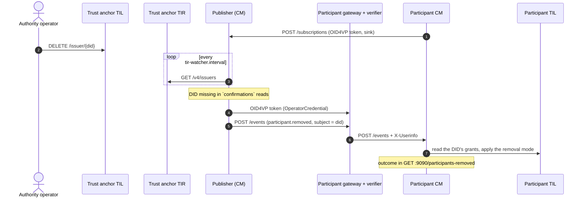

# Data Space Eventing

A participant's connector trusts the other members of the data space through grants in its own
Trusted Issuers List (TIL): a membership grant written at registration, order grants written when a
contract is bought. When the data space authority removes a member from the Trusted Issuers Registry
(TIR), nothing told the participants so far: the removed organization kept every grant it held.
**Data space eventing** closes that gap. A *publisher* at the trust anchor watches the TIR and sends
an `org.fiware.dataspace.participant.removed` event to every participant that subscribed; each
participant reports or revokes the removed member's trust, as its operator configured.

The protocol is described in the [architecture](eventing/architecture.md) and the
[interoperability specification](eventing/specification.md). The operator guides are the
[trust anchor setup](eventing/trust-anchor-setup.md) and the
[participant setup](eventing/participant-setup.md). The decisions are recorded as
[ADRs](adr/README.md).

<!-- START doctoc generated TOC please keep comment here to allow auto update -->
<!-- DON'T EDIT THIS SECTION, INSTEAD RE-RUN doctoc TO UPDATE -->

- [The flow](#the-flow)
- [Components](#components)
- [Demo](#demo)
- [Integration tests](#integration-tests)
- [Further reading](#further-reading)

<!-- END doctoc generated TOC please keep comment here to allow auto update -->

## The flow

1. Each participant's contract-management (CM) subscribes at the publisher. It authenticates with
   its MembershipCredential over OID4VP and registers the sink it receives events on.
2. The operator removes a participant from the trust anchor's TIL (`DELETE /issuer/{did}`).
3. The publisher's TIR watcher sees the DID missing in `confirmations` consecutive reads and
   publishes the removal.
4. The publisher authenticates at each subscriber's verifier with the authority's
   OperatorCredential and delivers the event to the sink, through the subscriber's API gateway.
5. The subscriber's CM applies its removal mode to the grants the removed DID holds for this
   publisher: `report` (the default) only records them; `dataspace` revokes the membership grant;
   `granted` and `full` go further ([participant setup](eventing/participant-setup.md)).
6. A periodic reconciliation sweep compares the local grants with the TIR, so a participant that
   missed the event reaches the same state.



## Components

| Component | Release / namespace in k3s | Values |
|---|---|---|
| Publisher: CM with publisher and TIR watcher, its `/subscriptions` routes and verifier service | `consent-authority` / `trust-anchor`, host `dataspace-events.127.0.0.1.nip.io` | [`k3s/eventing-trust-anchor.yaml`](../k3s/eventing-trust-anchor.yaml) |
| TIR and TIL the publisher watches | `trust-anchor` / `trust-anchor` | unchanged |
| Provider: CM listener and subscriber, `/events` routes, verifier service, ODRL policy | `provider` / `provider`, sink `contract-management.127.0.0.1.nip.io` | [`k3s/eventing-provider.yaml`](../k3s/eventing-provider.yaml) |
| Consumer: the same, with the consumer's CM | `consumer` / `consumer`, sink `contract-management-fancy-marketplace.127.0.0.1.nip.io` | [`k3s/eventing-consumer.yaml`](../k3s/eventing-consumer.yaml) |

The publisher reuses the authority's identity `did:web:dataspace-authority.org`, its key and its
OperatorCredential; the participants already trust it as that credential's issuer. Both participants
run in `report` mode, so the demo changes no grant unless you switch the mode.

The k3s values shorten CM's clocks so a removal arrives in about 30 s; the
[trust anchor setup](eventing/trust-anchor-setup.md#timing-production-defaults-and-the-k3s-values)
lists them next to the production defaults.

## Demo

Deploy the data space with the publisher:

```shell
mvn clean deploy -Peventing
export KUBECONFIG=$(pwd)/target/k3s.yaml
```

`-Plocal,eventing` deploys the same; `-Pconsent,eventing` is not supported
([local deployment](deployment-integration/local-deployment/LOCAL.MD)).
[`doc/scripts/dataspace-eventing-demo.sh`](scripts/dataspace-eventing-demo.sh) drives the demo. It
needs `curl`, `jq`, `kubectl` and `python3`, and reaches the management port 9090 of each CM through
a port-forward.

Check that the watcher reads the TIR: `snapshotSize` counts the members it knows.

```shell
doc/scripts/dataspace-eventing-demo.sh health publisher
```

```json
"dataspace-tir-watcher": {
  "status": "UP",
  "details": {
    "state": "...",
    "lastSuccessfulCycle": "2026-11-20T10:15:02Z",
    "snapshotSize": 3,
    "pendingSize": 0,
    "undeliveredSize": 0
  }
}
```

Remove the consumer from the trust anchor:

```shell
doc/scripts/dataspace-eventing-demo.sh remove did:web:fancy-marketplace.biz
```

```text
removing did:web:fancy-marketplace.biz at 2026-11-20T10:15:10Z
204
```

About 30 s later the provider's report shows the removal. In `report` mode nothing is written:
`action` is `reported`, `applied` is `false`, and `held` lists the grants the consumer still holds.

```shell
doc/scripts/dataspace-eventing-demo.sh report provider
```

```json
[
  {
    "publisher": "did:web:dataspace-authority.org",
    "mode": "report",
    "participants": [
      {
        "id": "did:web:fancy-marketplace.biz",
        "trigger": "event",
        "lastSeen": "2026-11-20T10:15:41Z",
        "mode": "report",
        "action": "reported",
        "applied": false,
        "held": [
          { "scope": "did:web:dataspace-authority.org", "scopeType": "dataspace-membership", "credentialCount": 3 }
        ],
        "unattributedCount": 0
      }
    ]
  }
]
```

The output is abridged. `report consumer` shows the consumer's own view. Register the consumer again
when done:

```shell
doc/scripts/dataspace-eventing-demo.sh restore did:web:fancy-marketplace.biz
```

```text
201
```

`publish <did>` announces a removal at once, without waiting for the watcher, and returns the number
of subscriptions the event went to (2 in k3s). To see a mode that writes, switch the provider to
`dataspace` as the [participant setup](eventing/participant-setup.md) describes, place an order as
the consumer, and remove it again: the membership grant goes, the order grant stays.

## Integration tests

The feature [`it/src/test/resources/it/dataspace_eventing.feature`](../it/src/test/resources/it/dataspace_eventing.feature),
tagged `@eventing` and implemented by `DataSpaceEventingStepDefinitions`, runs five scenarios against
the k3s deployment:

| Scenario | What it shows |
|---|---|
| With the default report mode a removal changes nothing | the default writes nothing; the report lists the grants held |
| In dataspace mode only the membership grant is removed | the publisher's membership grant goes, the order grant stays |
| An identifier on keep is untouched | a DID on `keep` is reported as kept, its grant stays |
| With the push path blocked the reconciliation sweep reaches the same state | with the publisher scaled down, the start-up sweep revokes the same grant |
| An entry attributed to another data space survives | a membership grant of another data space and the order grant stay |

Deploy and test in one command, as CI does in both deployment modes:

```shell
mvn clean integration-test -Ptest,eventing,eventing-test
```

`eventing-test` filters to `@eventing`; add `helm-install` for the Helm path. The scenarios switch
the provider's removal mode by patching its `contract-management-dataspace-events` ConfigMap and
restore it, the consumer's TIR entry and the publisher's replica count in an `@After` hook, so they
can run repeatedly on one cluster. To test against a data space that is already deployed, run
`mvn verify -pl it -Peventing,eventing-test`.

## Further reading

- [Architecture](eventing/architecture.md): event model, APIs, trust, delivery and the decision
  register.
- [Interoperability specification](eventing/specification.md): the contract a non-FIWARE publisher
  or subscriber follows.
- [Trust anchor setup](eventing/trust-anchor-setup.md): running the publisher.
- [Participant setup](eventing/participant-setup.md): receiving events, the removal modes and the
  gateway routes.
- [ADR 0008](adr/0008-events-routes-as-validated-operator-snippet.md): why the events routes are a
  validated operator snippet.
