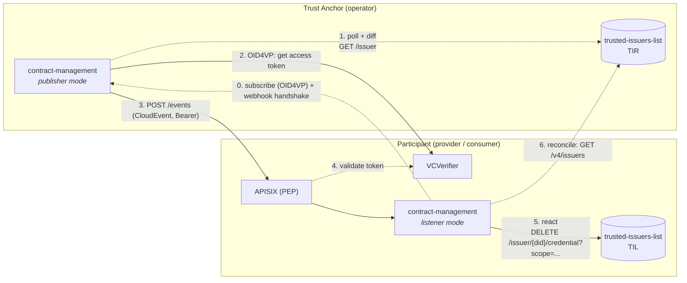

# Data Space Eventing — How It Works

A data space needs a way for one of its entities to tell the others that something happened. **Data
space eventing** is that channel, and the first thing carried on it is the news that a participant
was removed from the data space.

This document explains the mechanism: what the problem is, how an event travels from the trust
anchor to a participant, how a receiver decides whether to believe it, and what it does with it. It
is background reading for an operator who wants to understand the feature before enabling it, and
for anyone extending it.

| If you want to | Read |
|---|---|
| see the feature work in the local deployment | [EVENTING.md](../EVENTING.md) |
| enable it at a participant | [participant setup](participant-setup.md) |
| run the publisher at a trust anchor | [trust anchor setup](trust-anchor-setup.md) |
| implement either end without FIWARE components | [interoperability specification](specification.md) |

The specification is the normative contract. Where this document describes the wire — status codes,
payload members, headers — it describes it informally and the specification wins.

<!-- ToC created with: https://github.com/thlorenz/doctoc -->

- [1. The problem](#1-the-problem)
- [2. Overview](#2-overview)
- [3. Events](#3-events)
- [4. Trust and authorization](#4-trust-and-authorization)
- [5. Delivery](#5-delivery)
- [6. Detecting the removal at the trust anchor](#6-detecting-the-removal-at-the-trust-anchor)
- [7. Why local trust needs attribution](#7-why-local-trust-needs-attribution)
- [8. Reacting to a removal](#8-reacting-to-a-removal)
- [9. Reconciliation: the backstop](#9-reconciliation-the-backstop)
- [10. Failure modes and security considerations](#10-failure-modes-and-security-considerations)
- [11. Where the decisions are recorded](#11-where-the-decisions-are-recorded)
- [12. What this opens up](#12-what-this-opens-up)

## 1. The problem

Trust in a FIWARE data space is evaluated against two lists, per credential type, by the
participant's VCVerifier (see `k3s/provider.yaml`, `oidcScopes.*.credentials[]`):

| List | Who owns it | Configured as |
|---|---|---|
| Trusted Issuers Registry (TIR) — a data space's participant list | the trust anchor / operator | `trustedParticipantsLists` |
| Trusted Issuers List (TIL) — who *this* participant accepts credentials from | the participant | `trustedIssuersLists` |

The verifier runs every configured validation service and requires all of them to pass, so an issuer
normally has to be in the global TIR **and** in the local TIL. There is one important exception:
when a credential configuration names **no** participants list, the participant check returns `true`
for everybody and the local TIL alone decides. (A third case exists — for a trusted Gaia-X
credential chain the verifier skips both registry checks — but there neither list is consulted, so
it is not affected by any of this.)

When the operator removes a participant from the TIR (`DELETE /issuer/{did}` on the trust anchor's
trusted-issuers-list), nothing tells the other participants. The consequences are:

1. **Dangling entries.** Every participant that ever traded with the removed organization keeps TIL
   entries for its identifier — written by contract-management when an order is activated, by the
   chart's `registration.issuer` values, or by hand. Nothing ever removes them.
2. **A latent, configuration-dependent hole.** For every service whose credential configuration
   omits `trustedParticipantsLists`, those dangling entries are not stale decoration — they are a
   live grant. The organization stays able to issue credentials that open that service.
3. **No visibility.** Even where the entries are inert, an operator has no way to see that its local
   trust configuration refers to organizations the data space no longer knows.

The same gap exists for other facts: without this feature there is **no channel at all** through
which one entity of a data space can tell another that something happened. Each new need — a
provider handing a consumer the configuration of a service it just bought, a trust anchor announcing
a new participant, a revocation notice — would otherwise grow its own bespoke callback.

> **Participant identifiers are not necessarily `did:web`.** Nothing in the connector constrains the
> DID method a participant uses, so no part of this mechanism derives a host, a key or a document
> location from an identifier. That rules out two otherwise attractive shortcuts — discovering a
> participant's event endpoint from its DID document, and validating a callback URL against the
> participant's domain ([§4](#4-trust-and-authorization),
> [ADR 0013](../adr/0013-cloudevents-webhook-handshake.md)).

## 2. Overview



0. On start-up, and periodically afterwards, the participant's contract-management **subscribes** at
   the configured publishers, authenticating over OID4VP. The publisher confirms the callback — the
   *sink* — with the CloudEvents webhook handshake before it activates the subscription.
1. The publisher at the trust anchor — a contract-management instance deployed there in publisher
   mode — **watches the TIR** and derives `participant.removed` events from it ([§6](#6-detecting-the-removal-at-the-trust-anchor)).
2. For each subscriber, it obtains an access token at the **subscriber's** verifier by presenting
   the authority's credential — the same path contract-management already uses to notify a provider
   about an order.
3. It `POST`s the event to the sink, through the subscriber's gateway.
4. The gateway validates the token and applies an ODRL policy that restricts the events path to
   holders of the agreed credential type.
5. The receiver authorizes the *event type* against the authenticated publisher identifier,
   deduplicates, and applies the configured reaction to the TIL entries **attributable to that data
   space** ([§7](#7-why-local-trust-needs-attribution), [§8](#8-reacting-to-a-removal)).
6. Independently of all of the above, the receiver periodically **reconciles** those same entries
   against that data space's TIR. This is the backstop that makes the mechanism safe to build
   without durable delivery ([§9](#9-reconciliation-the-backstop)).

Both ends are the same component — contract-management — in two modes, because it already receives
authenticated events, already sends them over OID4VP, and already registers callbacks at start-up
with retry and a health indicator ([ADR 0009](../adr/0009-cloudevents-over-oid4vp.md)).

## 3. Events

An event is a **CloudEvent 1.0**, sent over the CloudEvents HTTP Protocol Binding in structured
content mode with the media type `application/cloudevents+json`. The attributes that carry meaning
here:

| Attribute | Meaning |
|---|---|
| `id` | unique per publisher; the **deduplication key** together with `source` |
| `type` | reverse-DNS, `org.fiware.dataspace.<entity>.<past-tense-verb>`; a receiver accepts and ignores types it does not know |
| `source` | the identifier of the publishing entity. It must equal the identity authenticated at the transport layer ([§4](#4-trust-and-authorization)), and it is what identifies the data space to the receiver |
| `subject` | the entity the event is about — for participant events, its identifier, in whatever DID method it uses |
| `data` | type-specific payload, versioned with the `type`: a breaking change is a new `type` |
| `dataspaceid` | optional extension attribute. Most data spaces have no identifier of their own; where one exists it may be carried, and a receiver that has one configured rejects an event carrying a different one |

One event type is defined today:

| Type | `subject` / `data` | Emitted when |
|---|---|---|
| `org.fiware.dataspace.participant.removed` | the removed participant's identifier, in `subject` and in `data.participantId` | an identifier that was in the TIR is gone from it |

There is deliberately **no `reason`**: the watcher of [§6](#6-detecting-the-removal-at-the-trust-anchor)
cannot know one, nothing in the receiver branches on it, and an attribute that is advisory in
practice but looks authoritative invites per-reason defaults. A later, better-informed source of
removals can introduce its own type.

Reserved for later, so that the namespace stays coherent, and not implemented:
`participant.registered`, `participant.credentials.changed`, `participant.suspended`,
`service.configuration.provided` ([§12](#12-what-this-opens-up)).

**Two small APIs** carry this, both specified in contract-management's `api/dataspace-events.yaml`
and normatively described in [specification §7](specification.md#7-receiving-endpoint) and
[§8](specification.md#8-subscription-profile):

- **`POST /events`** at the receiver — the sink. It is idempotent on (`source`, `id`), accepts and
  ignores unknown types rather than rejecting them, so a data space can introduce a type without a
  flag day, and is published through the participant's gateway. `OPTIONS /events` answers the
  webhook handshake, unauthenticated.
- **`POST /subscriptions`**, `DELETE /subscriptions/{id}` at the publisher. The subscriber calls
  them authenticated over OID4VP; the request borrows the shape of the CloudEvents Subscriptions API
  (`sink`, `types`, `protocol`, `protocolsettings`) without claiming conformance to it.

Deliberately absent: a catch-up feed (`GET /events?since=`), a broker and a queue
([ADR 0015](../adr/0015-best-effort-stateless-event-delivery.md)).

## 4. Trust and authorization

The sender authenticates with exactly the mechanism used for the central-marketplace notification
([CENTRAL_MARKETPLACE.md](../CENTRAL_MARKETPLACE.md), step 4): it presents a verifiable credential
it holds, over OID4VP, at the **receiver's** verifier, and uses the returned access token as a
bearer.

At the receiver, three checks apply, in this order:

1. **Gateway and ODRL policy (transport).** A policy restricts the events path to holders of an
   agreed credential type, for example an `OperatorCredential` issued by the authority. The type is
   **not fixed by the connector and not a data space-wide parameter**: each participant configures
   which credential it admits to its own events path, as it already does for the
   `MarketplaceCredential` of the central marketplace.
2. **Publisher authorization (application).** contract-management resolves the authenticated holder
   identifier from the forwarded token and checks it against its configured publishers. A publisher
   is known by two things: its **identifier**, which authorizes the event, and its **origin** — a
   DNS name — which is what the webhook handshake works on. They are configured together and
   deliberately not derived from one another, for the reason the box in [§1](#1-the-problem) gives.

   An event whose `source` differs from the authenticated identifier, or whose `type` that publisher
   is not configured for, is `403`. **This is the check that matters**: without it, every
   organization holding the credential needed to reach the endpoint — in a typical configuration,
   every participant — could announce the removal of any other participant and have its competitors'
   trust entries deleted. A policy on the credential *type* alone cannot express "only this
   publisher" ([ADR 0011](../adr/0011-authorize-events-per-publisher-and-type.md)).
3. **Self-events are ignored.** An event whose subject is this participant's own identifier is
   recorded and reported but never acted on; it would otherwise be a remote self-destruct.

**The callback is confirmed, not derived.** Before a subscription becomes active, the publisher
sends `OPTIONS <sink>` with its own origin in `WebHook-Request-Origin` and activates the
subscription only if the sink answers with a matching `WebHook-Allowed-Origin`; every delivery then
repeats the header. An endpoint that did not agree to receive from this publisher does not answer
the handshake, so the subscription API cannot be turned into an amplifier that makes the trust
anchor POST authenticated traffic at an arbitrary host
([ADR 0013](../adr/0013-cloudevents-webhook-handshake.md)).

**The publisher list is runtime configuration, not start-up configuration.** A data space may gain a
second trust anchor, or a participant may join another data space, without a restart being an
acceptable cost. The list is held in a refreshable configuration bean fed from a mounted ConfigMap,
so a `helm upgrade` or a `kubectl apply` on the ConfigMap takes effect without recreating the pod
([participant setup](participant-setup.md#when-configuration-changes-take-effect)).

**How the holder identifier is obtained.** The token is a JWT minted by the receiver's own VCVerifier
and it carries the presented credential. The gateway verifies it and passes the claims on; what
reaches the comparison with `source` is the credential subject by default, or the issuer under a
documented issuer binding ([specification §5.2](specification.md#52-caller-identity)).

The event payload itself is **not signed** — authentication is the transport's job
([ADR 0016](../adr/0016-no-event-payload-signature.md)).

## 5. Delivery

| Property | How it behaves |
|---|---|
| Direction | push, publisher to subscriber |
| Guarantee | **at-least-once, best effort** — in-memory retry with exponential backoff and a bounded attempt count, then dropped with an error log and a metric |
| Ordering | none; events carry `time` and are idempotent |
| Duplicates | expected; receivers deduplicate on (`source`, `id`) |
| Loss | possible — covered, for this event type, by the reconciliation sweep of [§9](#9-reconciliation-the-backstop) |
| Subscriptions | leased and held in memory; subscribers renew on a timer, and a publisher restart drops them until they re-register |

This is a deliberate trade. No party needs auditable proof that a removal notice was delivered, and
a durable outbox would mean a database for contract-management, which today is completely stateless.
For `participant.removed` the cheaper and *more* reliable answer is that the authoritative state —
the TIR — is public and can be re-read at any time, so a lost event costs latency, not correctness
([ADR 0015](../adr/0015-best-effort-stateless-event-delivery.md)).

An event type that cannot be reconciled from authoritative state — the reserved
`service.configuration.provided`, where the event *is* the state — must not be carried this way. Its
introduction is the point at which a durable outbox is added. The wire contract does not change when
that happens, which is why the publisher keeps its own identity for `source` and its own `id` space
from the start.

## 6. Detecting the removal at the trust anchor

The watcher is part of the **publisher-mode contract-management instance the operator runs in the
trust anchor's namespace** — not the trusted-issuers-list, and not a separate process. It **watches
the registry and diffs it**; the registry is not instrumented.

```
every tir-watcher.interval:
  snapshot := enumerate GET /issuer   (all pages, trusted-issuers-list management API)
  if the enumeration did not complete       -> discard, keep the previous snapshot, warn
  missing := previous \ snapshot
  for each id in missing:
      missingSince[id]++                     (confirmation counter)
      if missingSince[id] == confirmations   -> emit participant.removed
  for each id in snapshot: missingSince.remove(id)
  if |missing| > max-removals-per-cycle      -> emit nothing, alert, keep the previous snapshot
  previous := snapshot
```

**Why diffing and not a hook in the trusted-issuers-list.** The FIWARE trusted-issuers-list is *one*
implementation of the TIR; any EBSI-compatible registry, including blockchain-backed ones, may be
used ([operator guide](../deployment-integration/roles/operator/README.md)). A webhook inside the
FIWARE implementation would only ever work for deployments that use it. Diffing works against any
registry that can be enumerated, and it also catches removals made directly in the database or by a
migration, which no application-level hook would see
([ADR 0010](../adr/0010-detect-removal-by-diffing-the-registry.md)).

**The safeguards are not optional.** A diffing watcher turns *any* failure that makes the registry
look empty — a truncated page, a database that comes up without its data, a misconfigured base URL —
into a mass-removal announcement that would delete trust configuration at every participant in the
data space. Hence: only a completed enumeration becomes a snapshot; an identifier must be absent for
`confirmations` consecutive cycles before it is announced; more than `max-removals-per-cycle`
disappearances at once emits nothing and raises an alert for a human; and the first snapshot after a
start is taken silently, so a fresh publisher announces nothing.

**Latency** is therefore `interval × confirmations` — about two minutes with the shipped defaults,
which is appropriate for a governance action that is itself manual. The
[trust anchor setup](trust-anchor-setup.md#timing-production-defaults-and-the-k3s-values) lists the
defaults next to the shortened values the local deployment uses. If a data space ever promises a
shorter propagation time, a webhook from the FIWARE trusted-issuers-list becomes worth building *on
top of* the watcher, which stays the backstop for registries that cannot emit one.

**Manual publication.** The publisher also exposes an operator-only publish endpoint on its
management port, not published through the gateway, so an operator script or an onboarding portal
can announce a removal immediately. The watcher then sees the identifier disappear and the receivers
deduplicate against the event that was already published.

## 7. Why local trust needs attribution

A participant may be a member of several data spaces, and its TIL legitimately contains issuers that
belong to none of them. A removal announced by one data space therefore cannot be answered by
looking at the TIL as a whole — the connector has to know **why** a local entry exists before it may
touch it.

The trusted-issuers-list already records that: every credential it holds is attributed to the
**scope** that granted it. This mechanism extends the existing attribution rather than adding a
second one — entries that exist *because* an organization is a member of a data space are granted
under that data space's scope. The scope is a free-form string holding order ids, so rather than
reserve a prefix inside it, the grant carries a **type**:

| Origin of the entry | `scope` | `scopeType` | Meaning |
|---|---|---|---|
| contract-management, on order activation | the ProductOrder id | *(none)* | "this order grants them this" |
| membership registration — chart `registration.issuer`, onboarding portal | the publisher id | `dataspace-membership` | "I trust them because they are a member of that data space" |
| operator by hand, or anything created before this feature | *(none)* | *(none)* | unattributed; outside the mechanism |

The addition is backwards compatible in both directions: the column is nullable, so every existing
row stays valid, and a scoped call that passes no `scopeType` addresses the **untyped** grants only
— which is exactly what every caller writing order scopes does today, so none of them can reach a
membership grant by accident, and none of them has to change. The scope stays **internal to the
trusted-issuers-list and its management API**; it is never exposed through a TIR projection
([ADR 0012](../adr/0012-attribute-local-trust-to-the-dataspace.md)).

## 8. Reacting to a removal

The reaction is configured per publisher, and the default changes nothing:

| Mode | Action |
|---|---|
| `report` *(default)* | record and report only; no local state changes |
| `dataspace` | drop what this data space's membership granted |
| `granted` | as `dataspace`, plus every order-scoped grant to that identifier |
| `full` | drop the issuer entirely, including other data spaces' entries and unattributed ones |

`report` is the default because an operator action in someone else's namespace should not silently
delete trust configuration here. Per-identifier overrides refine the mode, and a `keep` list is
never touched by any mode or sweep; the
[participant setup](participant-setup.md#reacting-to-a-removed-participant) has the configuration.

**Unattributed entries are never removed automatically** in any mode but `full` — including the
entries that exist in every deployment that predates the scoping. They appear in the report instead.
For a participant that is a member of exactly one data space, an opt-in setting treats them as that
data space's membership grants, which is the migration path for an existing installation; it refuses
to act when more than one publisher is configured, because then nothing can say which data space an
unattributed entry belongs to.

**Every mode is answered per publisher.** An identifier attributed to two data spaces and removed by
one keeps the other's entries, in every mode but `full`, which is documented as the blunt instrument
it is.

**The report is part of the feature, not an extra.** Whatever the mode, the participant ends up with
a record of "that data space removed X; this is what I hold for X and what I did about it", as a log
line, a metric, and the removal report on contract-management's management port
(`GET :9090/participants-removed`). Without it, `report` would quietly accumulate exactly the
situation this set out to fix.

**What is deliberately not touched.** ODRL policies at the PAP, Rainbow/EDC agreements, running
access tokens, and credentials already issued to the organization's users. Reporting them is enough
for now: policies and agreements belong to orders, which the default behaviour keeps, and token
lifetimes are short.

## 9. Reconciliation: the backstop

Enabled with the feature, the participant periodically — and once after start-up — compares, **for
each configured publisher separately**, the entries attributable to that data space against that
data space's registry:

```
for each publisher P with registry R:
    attributed := GET /issuer?scope=<P>&scopeType=dataspace-membership   (TIL management API)
    members    := enumerate GET R/v4/issuers
    stale      := attributed \ members \ keep
    apply the configured mode for P to stale
```

Asking the question per data space, over the entries that data space's membership created, is both
answerable and safe. Asking it over the TIL as a whole would not be: a participant may use many
registries — a verifier can be configured with a different `trustedParticipantsLists` per credential
type and per service — so "in my TIL but not in that TIR" says nothing about whether an entry is
stale. With the question asked per publisher, an issuer that belongs to two data spaces keeps the
entries of the one it is still a member of, and an issuer that belongs to none of them is never
considered at all.

This costs two paginated reads per publisher a few times a day and buys: recovery from any lost
event, correct behaviour for a participant installed after a removal happened, and a deployment that
is never *dependent* on the push path being reachable — which is what lets delivery stay stateless
([§5](#5-delivery)). It introduces no new trust relationship: the participant's verifier already
polls those same registries for every credential validation.

The sweep is configured once for all publishers; the
[participant setup](participant-setup.md#reconciliation) has the keys and the defaults.

## 10. Failure modes and security considerations

| Failure | Effect | Mitigation |
|---|---|---|
| Registry briefly unreachable or returns a partial list | mass false removals announced | only complete enumerations become snapshots; `confirmations` cycles; the `max-removals-per-cycle` circuit breaker; the first snapshot is silent |
| Publisher restarts | subscriptions lost, events missed | subscribers renew on a timer; the reconciliation sweep |
| Participant unreachable | event lost after retries | the reconciliation sweep |
| Spoofed removal by another participant | trust entries deleted across the data space | publisher × type authorization ([§4](#4-trust-and-authorization)); the token is verified by the gateway; self-events ignored |
| Subscription API pointed at a third party | the trust anchor POSTs authenticated traffic at a host that never asked for it | the webhook handshake — a sink that does not consent is never activated; per-subscriber cap; lease expiry |
| Replayed event | repeated cleanup | (`source`, `id`) deduplication; handlers converge; an entry re-created by a later order carries the order's scope and survives `dataspace` mode |
| Operator removes a participant by mistake | trust entries deleted at every participant | `confirmations`, the circuit breaker, the `report` default, and the report that lets an operator see and undo |
| Participant is a member of two data spaces, one removes it | the other data space's trust is destroyed | attribution per publisher ([§7](#7-why-local-trust-needs-attribution)); `full` is documented as blunt |
| An onboarding portal removes a participant from a TIL with `DELETE /issuer/{did}` | order-granted and other data spaces' entries are dropped too | a portal registers with the membership scope and removes only that scope's credentials |
| Unattributed legacy entries | invisible to the sweep, never cleaned | listed in the report; `registration.issuer` carries a scope going forward; the opt-in adoption setting for single-membership deployments |

## 11. Where the decisions are recorded

| ADR | Decision |
|---|---|
| [0008](../adr/0008-events-routes-as-validated-operator-snippet.md) | The events routes are a validated operator snippet, not chart routes |
| [0009](../adr/0009-cloudevents-over-oid4vp.md) | Events are CloudEvents authenticated over OID4VP, in contract-management, configured under `dataspace.events` |
| [0010](../adr/0010-detect-removal-by-diffing-the-registry.md) | Removals are detected by diffing the registry, not by instrumenting it |
| [0011](../adr/0011-authorize-events-per-publisher-and-type.md) | Events are authorized per publisher and type |
| [0012](../adr/0012-attribute-local-trust-to-the-dataspace.md) | Local trust is attributed to the data space that caused it |
| [0013](../adr/0013-cloudevents-webhook-handshake.md) | Callbacks are confirmed with the CloudEvents webhook handshake |
| [0014](../adr/0014-publisher-in-the-authority-release.md) | The publisher runs in the authority's release, reusing its identity |
| [0015](../adr/0015-best-effort-stateless-event-delivery.md) | Delivery is best-effort from stateless publishers; reconciliation is the guarantee |
| [0016](../adr/0016-no-event-payload-signature.md) | The event payload is not signed; authentication is the transport's job |

## 12. What this opens up

- **`service.configuration.provided`** — the provider hands the consumer the configuration of a
  service it has bought, instead of the consumer polling or receiving it out of band. Same envelope,
  same authentication; it is the event type that will require durable delivery ([§5](#5-delivery)).
- **`participant.registered` / `credentials.changed`** — a participant can pre-populate or refresh
  local configuration without waiting for a first failed call.
- **Status and revocation notices** alongside the status-list server, for consumers that want to
  react rather than poll.
- **A second publisher** is just another entry in the publisher list: a sectoral authority, a second
  trust anchor, or a marketplace announcing catalogue changes — and, with per-publisher attribution,
  a second data space.
