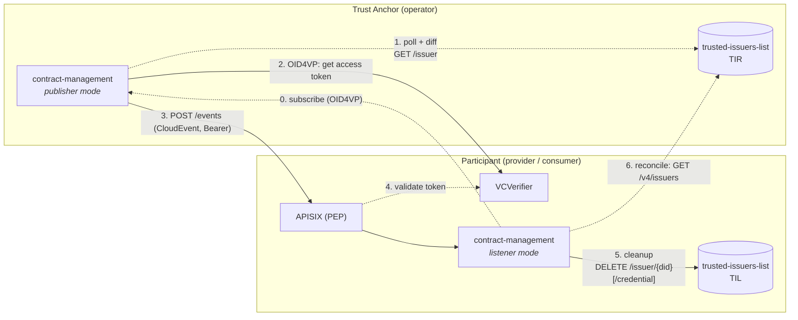

# Data Space Eventing

**Status:** Draft for review
**Date:** 2026-10-28
**Scope:** a generic, OID4VP-authenticated event mechanism between the entities of a data space, and
one concrete event — *a participant was removed from the data space* — that lets every participant
clean up its local Trusted Issuers List.

<!-- ToC created with: https://github.com/thlorenz/doctoc -->

- [1. Problem](#1-problem)
- [2. Goals and non-goals](#2-goals-and-non-goals)
- [3. Overview](#3-overview)
- [4. The event model](#4-the-event-model)
- [5. The APIs](#5-the-apis)
- [6. Trust and authorization](#6-trust-and-authorization)
- [7. Delivery semantics](#7-delivery-semantics)
- [8. Detecting the removal at the trust anchor](#8-detecting-the-removal-at-the-trust-anchor)
- [9. Reacting to the removal at the participant](#9-reacting-to-the-removal-at-the-participant)
- [10. Reconciliation: the backstop](#10-reconciliation-the-backstop)
- [11. Deployment](#11-deployment)
- [12. Decision register](#12-decision-register)
- [13. Failure modes and security considerations](#13-failure-modes-and-security-considerations)
- [14. What this opens up](#14-what-this-opens-up)
- [15. Impact per repository](#15-impact-per-repository)

## 1. Problem

Trust in a FIWARE data space is evaluated against two lists, per credential type, by the
participant's VCVerifier (see `k3s/provider.yaml`, `oidcScopes.*.credentials[]`):

| List | Who owns it | Configured as |
|---|---|---|
| Trusted Issuers Registry (TIR) — the data space's participant list | the trust anchor / operator | `trustedParticipantsLists` |
| Trusted Issuers List (TIL) — who *this* participant accepts credentials from | the participant | `trustedIssuersLists` |

The verifier runs every configured validation service and requires all of them to pass
(`VCVerifier/verifier/verifier.go`), so an issuer normally has to be in the global TIR **and** in
the local TIL. There is one important exception, implemented in
`VCVerifier/verifier/trustedparticipant.go`: when a credential configuration names **no**
participants list, the participant check returns `true` for everybody and the local TIL alone
decides. (A third case exists — for a trusted Gaia-X credential chain the verifier skips both
registry checks — but there neither list is consulted, so it is not affected by any of this.)

When the operator removes a participant from the TIR (`DELETE /issuer/{did}` on the trust anchor's
trusted-issuers-list), nothing tells the other participants. The consequences are:

1. **Dangling entries.** Every participant that ever traded with the removed organization keeps TIL
   entries for its DID — written by `contract-management` on order activation
   (`TrustedIssuersListAdapter.allowIssuer`, scoped to the ProductOrder id), by the chart's
   `registration.issuer` values, or by hand. Nothing ever removes them.
2. **A latent, configuration-dependent hole.** For every service whose credential configuration
   omits `trustedParticipantsLists`, those dangling entries are not stale decoration — they are a
   live grant. The organization stays able to issue credentials that open that service.
3. **No visibility.** Even where the entries are inert, an operator has no way to see that its local
   trust configuration refers to organizations the data space no longer knows.

The same gap exists in the other direction and for other facts: today there is **no channel at all**
through which one entity of a data space can tell another that something happened. Each new need
(a provider handing a consumer the configuration of a service it just bought, a trust anchor
announcing a new participant, a revocation notice) would otherwise grow its own bespoke callback.

## 2. Goals and non-goals

**Goals**

- A **generic** event mechanism between data space entities — trust anchor to participants first,
  participant to participant on the same mechanism later.
- Events are **authenticated with the mechanisms the connector already uses**: the sender presents a
  verifiable credential over OID4VP, the receiver authorizes it through its PEP exactly like any
  other cross-participant call.
- Events are **authorized per event type**: being a participant does not make you entitled to
  announce that another participant was removed.
- A participant **configures what an event does to its local state**, because removal from the data
  space does not necessarily end a bilateral relationship.
- Nothing new in the trust model: no new root of trust, no new key material, no shared secret, no
  message broker to operate.

**Non-goals (explicitly out of scope here)**

- Participant-to-participant configuration delivery after a purchase. The mechanism is designed so
  it can carry that later (§14); it is not implemented in this ticket.
- Cleaning up anything other than the TIL — ODRL policies at the PAP, Rainbow/EDC agreements,
  identityhub credentials — on a removal event (§9, "what is deliberately not touched").
- A general-purpose pub/sub bus with durable, auditable delivery guarantees for every event type
  (§7 says why that is deferred and what it would change).
- Changing how the operator removes a participant. The TIR management API stays as it is.

## 3. Overview



0. On start-up, and periodically afterwards, the participant's `contract-management` **subscribes**
   at the configured publishers, authenticating over OID4VP. This mirrors what it already does for
   TMForum notifications (`NotificationSubscriber`, callback registration with retry and a health
   indicator).
1. The publisher at the trust anchor **watches the TIR** and derives `participant.removed` events
   from it.
2. For each subscriber, it obtains an access token at the **subscriber's** verifier by presenting
   the trust anchor's credential — the `Oid4VpAuthHandler` / `OID4VPClient` path that
   `ContractManagementAdapter` already uses to notify a provider about an order.
3. It `POST`s the event through the subscriber's PEP.
4. The PEP validates the token and applies the ODRL policy that restricts the events path to holders
   of the agreed credential type — the same shape as `it/src/test/resources/policies/allowContractManagement.json`.
5. The receiver authorizes the *event type* against the authenticated publisher DID, deduplicates,
   and applies the configured reaction to its TIL.
6. Independently of all of the above, the receiver periodically **reconciles** its TIL against the
   trust anchor's public TIR. This is the backstop that makes the whole mechanism safe to build
   without durable delivery (§7, §10).

Both ends are the same component — `contract-management` — in two modes. §12 D-1 explains why.

## 4. The event model

Events are **CloudEvents 1.0** in JSON, structured mode (`Content-Type: application/cloudevents+json`).

```json
{
  "specversion": "1.0",
  "id": "urn:uuid:0f3b9a2c-1f3c-4a0e-9a2d-2d1b4f0a77c1",
  "type": "org.fiware.dataspace.participant.removed",
  "source": "did:web:trust-anchor.org",
  "subject": "did:web:fancy-marketplace.biz",
  "time": "2026-10-28T09:12:44Z",
  "dataspaceid": "did:web:trust-anchor.org",
  "datacontenttype": "application/json",
  "data": {
    "participantId": "did:web:fancy-marketplace.biz",
    "reason": "removed-from-registry",
    "observedAt": "2026-10-28T09:12:40Z",
    "registry": "https://tir.trust-anchor.org"
  }
}
```

| Attribute | Meaning |
|---|---|
| `id` | unique per event, the **deduplication key** together with `source` |
| `type` | reverse-DNS, `org.fiware.dataspace.<entity>.<past-tense-verb>`; a receiver ignores types it does not know |
| `source` | the DID of the publishing entity. Must equal the DID authenticated at the transport layer (§6) |
| `subject` | the entity the event is about — for participant events, its DID |
| `dataspaceid` | CloudEvents extension; identifies the data space, so one receiver can serve several |
| `data` | type-specific payload, versioned with the `type` — a breaking change is a new `type` |

**Event types defined here**

| Type | Payload | Emitted when |
|---|---|---|
| `org.fiware.dataspace.participant.removed` | `participantId`, `reason`, `observedAt`, `registry` | a DID that was in the TIR is gone from it |

`reason` is an enumeration (`removed-from-registry`, `revoked`, `expired`, `suspended`), so that a
later, richer source of removals can say *why* without changing the schema. The watcher of §8 can
only produce `removed-from-registry`.

**Types reserved for later** (named here so the namespace stays coherent, not implemented):
`participant.registered`, `participant.credentials.changed`, `participant.suspended`,
`service.configuration.provided` (§14).

## 5. The APIs

Two small APIs, both added to `contract-management` and specified in its `api/` folder as the
existing `contract-management.yaml` is (OpenAPI-first, code generated).

### 5.1 Receiving — `POST /events`

```
POST /events
Authorization: Bearer <access token from the receiver's verifier>
Content-Type: application/cloudevents+json

202 Accepted      the event was accepted (and handled, or queued for handling)
400 Bad Request   malformed envelope
401 Unauthorized  no/invalid token — the PEP answers this, and it triggers the sender's OID4VP flow
403 Forbidden     authenticated, but this publisher may not emit this type (§6)
422 Unprocessable the type is known but the payload is invalid
502 Bad Gateway   a downstream (the TIL) failed — the publisher should retry
```

- **Idempotent.** `(source, id)` is remembered for a configurable window (default 24h, in memory);
  a repeat returns `202` without acting again. The handlers are written to converge anyway, so a
  lost dedup entry after a restart is harmless.
- **Unknown types are accepted and ignored** with a log line and a metric, never rejected. A data
  space must be able to introduce a type without a flag day.
- The path is published through the participant's ingress/PEP, like `/order` is today.

### 5.2 Subscribing — `POST /subscriptions`

Offered by a publisher. The subscriber calls it authenticated over OID4VP.

```
POST /subscriptions
Authorization: Bearer <access token from the publisher's verifier>
{
  "subscriberId": "did:web:mp-operations.org",
  "callback": "https://contract-management.mp-operations.org/events",
  "types": ["org.fiware.dataspace.participant.removed"],
  "clientId": "contract-management",
  "scopes": ["dataspace-events"]
}

201 Created  { "id": "...", "expiresAt": "2026-10-28T10:12:44Z" }
```

- `subscriberId` **must** equal the DID authenticated in the request; the publisher does not take
  the caller's word for it.
- `callback` is validated against that DID: for `did:web:<domain>`, its host must be `<domain>` or a
  configured sub-domain of it. Without that check the subscription API is an amplifier that makes
  the trust anchor POST signed traffic at any host on request (the same reasoning as
  [ADR-0003](../adr/0003-token-endpoint-not-consent-proxy.md)'s "audience is a name, never a URL").
- `clientId`/`scopes` are what the publisher must use when it fetches an access token at the
  subscriber's verifier.
- Subscriptions are **leased** (default TTL 15 min) and held in memory. Subscribers renew them on a
  timer; a publisher restart loses them and the subscribers re-register. `DELETE /subscriptions/{id}`
  ends one early. §12 D-4 explains why a lease rather than a persisted registration.
- A publisher caps the number of subscriptions per DID (default 5) and in total.

### 5.3 What is deliberately *not* added

- **No catch-up feed** (`GET /events?since=`). It would need a durable, retained event log at the
  publisher, and it answers a question — "which participants are gone?" — that the TIR already
  answers directly and authoritatively. §10 uses the TIR instead.
- **No broker, no queue.** Nothing in the connector operates one today.

## 6. Trust and authorization

The sender authenticates with exactly the mechanism used for the central-marketplace notification
(`doc/CENTRAL_MARKETPLACE.md`, step 4): it presents a verifiable credential it holds, over OID4VP,
at the **receiver's** verifier and uses the returned access token as a bearer.

**At the receiver, three checks apply, in this order:**

1. **PEP / ODRL policy (transport).** A policy restricts the events path to holders of an agreed
   credential type, e.g. a `TrustAnchorCredential` issued by the operator. The credential type is
   not fixed by the connector — as with the `MarketplaceCredential` of the central marketplace, a
   data space picks its own and configures it on both sides.
2. **Publisher authorization (application).** `contract-management` resolves the authenticated
   holder DID from the forwarded token and checks it against its configured publishers:

   ```yaml
   publishers:
     - did: did:web:trust-anchor.org
       types: [ "org.fiware.dataspace.participant.removed" ]
   ```

   An event whose `source` differs from the authenticated DID, or whose `type` that publisher is not
   configured for, is `403`. **This is the check that matters**: without it every organization that
   holds the credential needed to reach the endpoint — in a typical configuration, every participant
   — could announce the removal of any other participant and have its competitors' trust entries
   deleted. A PEP policy on the credential *type* alone cannot express "only this DID".
3. **Self-events are ignored.** An event whose `subject` is this participant's own DID is recorded
   and reported but never acted on; it would otherwise be a remote self-destruct.

**How the holder DID is obtained.** The token is a JWT minted by the receiver's own VCVerifier and
it carries the presented credential (`jwtInclusion.fullInclusion: true` in the shipped
configuration). `contract-management` verifies it against the verifier's JWKS
(`/.well-known/jwks`) and reads the holder/issuer DID from it, rather than trusting a header the PEP
injects. That keeps check 2 valid even if the events path is ever exposed without a PEP in front —
and it is the only part of the mechanism that needs the verifier's address at the receiving side.

**Not done at this stage:** signing the event *payload* (a JWS by the publisher DID) so it is
verifiable independently of the transport. It would allow relaying and store-and-forward, and it is
additive to the envelope (a `signature` extension attribute). See [questions](questions.md) Q7.

## 7. Delivery semantics

| Property | This design |
|---|---|
| Direction | push, publisher to subscriber |
| Guarantee | **at-least-once, best effort** — in-memory retry with exponential backoff (default 5 attempts over ~5 min), then dropped with an error log and a metric |
| Ordering | none; events carry `time` and are idempotent |
| Duplicates | expected; receivers deduplicate on `(source, id)` |
| Loss | possible — covered, for this event type, by the reconciliation sweep of §10 |

This is a deliberate trade (§12 D-4). A durable outbox would mean a database for
`contract-management`, which today is **completely stateless** (no datasource, no Liquibase, nothing
to migrate), and a retention and audit policy for the event log. For `participant.removed` the
cheaper and *more* reliable answer is that the authoritative state — the TIR — is public and can be
re-read at any time, so a lost event costs latency, not correctness.

An event type that cannot be reconciled from authoritative state — the future
`service.configuration.provided`, where the event *is* the state — must not be carried this way. Its
introduction is the point at which a durable outbox is added. The API contract above does not change
when that happens, which is the reason the publisher keeps its own identity for `source` and its own
`id` space from the start.

## 8. Detecting the removal at the trust anchor

The publisher **watches the registry and diffs it**; the registry is not instrumented.

```
every events.publisher.tirWatch.interval (default 60s):
  snapshot := enumerate GET /issuer   (all pages, trusted-issuers-list management API)
  if the enumeration did not complete       -> discard, keep the previous snapshot, warn
  missing := previous \ snapshot
  for each did in missing:
      missingSince[did]++                    (confirmation counter)
      if missingSince[did] == confirmations  -> emit participant.removed
  for each did in snapshot: missingSince.remove(did)
  if |missing| > maxRemovalsPerCycle         -> emit nothing, alert, keep the previous snapshot
  previous := snapshot
```

**Why diffing and not a hook in the trusted-issuers-list.** The operator documentation states
explicitly that the FIWARE trusted-issuers-list is *one* implementation of the TIR and that any
EBSI-compatible registry — including blockchain-backed ones — may be used
(`doc/deployment-integration/roles/operator/README.md`). A webhook inside the FIWARE implementation
would only ever work for deployments that use it. Diffing works against any registry that can be
enumerated, and it also catches removals made directly in the database or by a migration, which no
application-level hook would see.

**The safeguards are not optional.** A diffing watcher turns *any* failure that makes the registry
look empty — a truncated page, a database that comes up without its data, a misconfigured base URL —
into a mass-removal announcement that would delete trust configuration at every participant in the
data space. Hence: only a completed enumeration becomes a snapshot; a DID must be absent for
`confirmations` consecutive cycles (default 2) before it is announced; more than
`maxRemovalsPerCycle` disappearances at once (default 5) emits nothing and raises an alert for a
human. The first snapshot after a start is taken silently — a fresh publisher announces nothing.

**Latency** is therefore `interval × confirmations` (default ~2 min), which is appropriate for a
governance action that is itself manual.

**Manual publication.** The publisher also exposes an operator-only `POST /events` of its own
(cluster-internal, not published through the ingress) so the onboarding portal or an operator script
can announce a removal immediately, with a `reason` the watcher cannot know. The watcher then sees
the DID disappear and deduplicates against the already-published event.

## 9. Reacting to the removal at the participant

A local TIL entry for a DID can come from three places, and they are distinguishable because the
trusted-issuers-list attributes granted credentials to the **scope** that granted them (a
ProductOrder id, see `TrustedIssuersListAdapter` and the `scope` parameter of
`/issuer/{did}/credential`):

| Origin | Scope | Meaning |
|---|---|---|
| chart `registration.issuer`, operator by hand | none | "I trust this organization", usually because it is a participant |
| `contract-management` on order activation | the ProductOrder id | "this order grants them this" |

The reaction is configurable along exactly that axis:

| `participantRemoval.mode` | Action | TIL call |
|---|---|---|
| `none` | record and report only | — |
| `unscoped` *(default)* | drop the directly managed entries, keep every order-backed grant | `DELETE /issuer/{did}/credential` without a scope |
| `granted` | drop the order-backed grants, keep what an operator configured by hand | `DELETE /issuer/{did}/credential?scope=<each>` |
| `full` | drop the issuer entirely | `DELETE /issuer/{did}` |

`unscoped` is the default because it removes precisely what the reported problem is about — trust
that exists *because the DID was a participant* — and keeps what a contract pays for, which is the
case the requirement calls out ("they might have contracts with the participant beyond the data
space"). Per-DID overrides exist for both directions:

```yaml
participantRemoval:
  mode: unscoped
  overrides:
    - did: did:web:long-term-partner.example.org
      mode: none            # bilateral agreement, independent of the data space
    - did: did:web:banned.example.org
      mode: full
```

**Two gaps in the trusted-issuers-list API that this needs** (see [ticket](ticket.md), TIL-1/TIL-2):
`DELETE /issuer/{did}/credential` currently *requires* a scope and answers `400` without one, so
there is no way to remove only the unscoped credentials; and no endpoint reports which scopes hold
credentials for an issuer, which both the `granted` mode and the report below need.

**The report is part of the feature, not an extra.** Whatever the mode, the participant ends up
with a record of "the data space removed X; I did/did not change my list", exposed as

- a log line and the metric `dsc_dataspace_events_participant_removed_total{action,mode}`,
- `GET /events/participants/removed` — the DIDs removed from the data space for which local entries
  still exist, with the scopes that hold them.

Without it, `none` and `unscoped` would quietly accumulate exactly the situation the ticket set out
to fix.

**What is deliberately not touched.** ODRL policies at the PAP, Rainbow/EDC agreements, running
access tokens, and credentials already issued to the organization's users. Policies and agreements
belong to orders, which survive by default; token lifetimes are short; and widening the blast radius
of a single remote event to the PAP is a decision that deserves its own round
([questions](questions.md) Q5).

## 10. Reconciliation: the backstop

Enabled with the feature, the participant periodically (default 6h, and once at start-up) compares
its own TIL against the trust anchor's TIR:

```
participants := GET <tir>/v4/issuers     (paginated, public, already read by the verifier)
local        := GET <til>/issuer         (paginated)
stale        := local \ participants \ keep-list
```

and applies the same `participantRemoval` policy to `stale`, with the same per-DID overrides and the
same reporting, capped by `maxRemovalsPerRun`.

This costs two paginated reads a few times a day and buys: recovery from any lost event, correct
behaviour for a participant that was installed after a removal happened, and — importantly — a
deployment that is never *dependent* on the push path being reachable. It is also the reason the
push path may stay stateless (§7).

It introduces no new trust relationship: the participant's verifier already polls that same TIR for
every credential validation.

> The keep-list matters here more than in the event path. A local TIL legitimately contains issuers
> that are not participants of this data space — a partner from another data space, an internal
> issuer. Those are configured as `participantRemoval.keep` and are never touched by either path.

## 11. Deployment

**At the participant** — values on the existing `contract-management` subchart:

```yaml
contract-management:
  events:
    # receive events
    listener:
      enabled: true
      publishers:
        - did: did:web:trust-anchor.org
          types: [ "org.fiware.dataspace.participant.removed" ]
      verifier:
        jwksUrl: http://verifier:3000/.well-known/jwks
    # register at the publishers
    subscriptions:
      - address: https://events.trust-anchor.org
        callback: https://contract-management.mp-operations.org/events
        clientId: dataspace-events
        scopes: [ default ]
        types: [ "org.fiware.dataspace.participant.removed" ]
        renewInterval: 10m
    # what a removal does
    participantRemoval:
      mode: unscoped
      keep: []
      overrides: []
      reconciliation:
        enabled: true
        interval: 6h
        tir: https://tir.trust-anchor.org
        maxRemovalsPerRun: 5
```

plus an ODRL policy that admits the trust anchor's credential type to the events path — shipped as
an example next to `it/src/test/resources/policies/allowContractManagement.json` — and the events
path on the contract-management ingress.

**At the trust anchor** — the publisher is the same image in a trimmed mode:

```yaml
contract-management:
  enabled: true
  did: did:web:trust-anchor.org
  enableTmForum: false
  enableOdrlPap: false
  enableTrustedIssuersList: false
  enableRainbow: false
  enableCentralMarketplace: false
  oid4vp:
    enabled: true                 # to authenticate towards the participants
    holder: { holderId: did:web:trust-anchor.org, ... }
  events:
    publisher:
      enabled: true
      tirWatch:
        enabled: true
        tir: http://tir:8080
        interval: 60s
        confirmations: 2
        maxRemovalsPerCycle: 5
```

The trust anchor needs an OID4VP identity it does not have today: a `did:web`, a signing key and a
credential the participants accept. Both existing ways to give it one work unchanged — the
`consent-authority` pattern (a second `data-space-connector` release in the trust anchor's
namespace providing keycloak, did-helper and a vc-operator, see `k3s/consent-trust-anchor.yaml`), or
mounting an externally issued credential and key from secrets, exactly as the consent-facade's
`oid4vp` block does in `k3s/consent-trust-anchor-components.yaml`. Which one the `trust-anchor`
chart should adopt as its documented path is [Q8](questions.md).

**Everything is off by default.** `events.listener.enabled`, `events.publisher.enabled` and
`reconciliation.enabled` all default to `false`, so an upgrade of an existing deployment changes
nothing.

## 12. Decision register

Proposed, not ratified — each is a candidate ADR (`doc/adr/`, see the ticket).

| # | Decision | Rationale | Alternative rejected |
|---|---|---|---|
| **D-1** | Both ends of the mechanism live in **contract-management**, in a publisher and a listener mode | It already receives authenticated events (`/order/*`), already sends them over OID4VP (`ContractManagementAdapter` + `Oid4VpAuthHandler`), and already registers callbacks at start-up with retry and a health indicator. A new service means a new repository, image, chart, CI and identity for code that exists | A dedicated `dataspace-events` service; extending the trusted-issuers-list |
| **D-2** | **CloudEvents 1.0** envelope, reverse-DNS types | A standard envelope with id/source/type/subject/time is exactly what dedup, routing and authorization need, and it is neutral between the use cases this must still carry | A TMForum hub/listener-shaped API (entity-centric, CRUD verbs, wrong altitude for a governance fact); a bespoke JSON body |
| **D-3** | Removals are detected by **polling and diffing the TIR**, not by a hook in the trusted-issuers-list | The TIR is explicitly pluggable, including third-party and blockchain-backed implementations; diffing is the only detection that works for all of them, and it also sees out-of-band changes | A webhook in the FIWARE trusted-issuers-list (possible later as a latency optimisation, with the watcher as backstop) |
| **D-4** | Delivery is **best-effort and stateless**; subscriptions are **leased and in memory** | Keeps contract-management stateless (it has no database at all today) and keeps the operational surface small. For this event type, the authoritative state is public and re-readable, so §10 is a stronger guarantee than an outbox | A persisted outbox and subscription registry with a database — required later for event types that cannot be reconciled |
| **D-5** | The receiver authorizes **publisher DID × event type** in the application, on top of the PEP | A PEP policy constrains the credential *type*; in a normal data space many organizations hold it. Without D-5 any of them could announce any other participant's removal | Relying on the ODRL policy alone; constraining the issuer DID in the policy (depends on PAP support, see Q3) |
| **D-6** | The participant's reaction is **configurable along the grant scope**, default `unscoped` | The scope already records *why* an entry exists, which is exactly the distinction "data space trust" vs "a contract we have" that the requirement asks to be configurable | A single on/off switch; always removing everything |
| **D-7** | A **reconciliation sweep** against the TIR ships with the feature | It is what makes D-4 defensible, and it fixes the installed base of dangling entries that predates the eventing | Eventing only |
| **D-8** | Callback addresses are **derived from the subscriber's authenticated DID**, never taken on trust | Otherwise the subscription API makes the trust anchor send authenticated traffic to any host on request | Accepting an arbitrary callback URL |

## 13. Failure modes and security considerations

| Failure | Effect | Mitigation |
|---|---|---|
| Registry briefly unreachable or returns a partial list | mass false removals announced | only complete enumerations become snapshots; `confirmations` cycles; `maxRemovalsPerCycle` circuit breaker; first snapshot is silent |
| Publisher restarts | subscriptions lost, events missed | subscribers renew on a timer; reconciliation sweep |
| Participant unreachable | event lost after retries | reconciliation sweep |
| Spoofed removal by another participant | trust entries deleted across the data space | D-5 publisher×type authorization, token verified against the verifier's JWKS, self-events ignored |
| Replayed event | repeated cleanup | `(source, id)` dedup; handlers converge; an entry re-created by a later order is scoped and survives `unscoped` |
| Subscription API abused as an amplifier | the trust anchor POSTs at a third party | D-8 callback/DID match; per-DID subscription cap; lease expiry |
| Operator removes a participant by mistake | trust entries deleted at every participant | `confirmations`, the circuit breaker, default `unscoped` rather than `full`, and the report that lets an operator see and undo |
| A data space runs two trust anchors | conflicting claims | `publishers` is a list and each entry is authorized per type; `dataspaceid` separates them |

## 14. What this opens up

- **`service.configuration.provided`** — the provider hands the consumer the configuration of a
  service it has bought, instead of the consumer polling or receiving it out of band. Same envelope,
  same auth; it is the event type that will require durable delivery (§7).
- **`participant.registered` / `credentials.changed`** — a participant can pre-populate or refresh
  local configuration without waiting for a first failed call.
- **Status/revocation notices** alongside the status-list server, for consumers that want to react
  rather than poll.
- A **second publisher** is just another entry in `publishers`: a sectoral authority, a second trust
  anchor, or a marketplace announcing catalogue changes.

## 15. Impact per repository

| Repository | Change |
|---|---|
| [contract-management](https://github.com/FIWARE/contract-management) | the whole mechanism: `/events`, `/subscriptions`, the watcher, the TIL cleanup, the reconciliation sweep, the report, configuration |
| [trusted-issuers-list](https://github.com/FIWARE/trusted-issuers-list) | two API additions: delete the unscoped credentials of an issuer; list the scopes holding credentials for an issuer |
| [helm-charts (contract-management chart)](https://github.com/FIWARE/helm-charts) | the `events` values block, the events path on the ingress |
| **data-space-connector** (this repo) | umbrella values + schema, trust-anchor chart wiring, example ODRL policy, k3s overlays, an integration test, documentation, release notes, ADRs |
