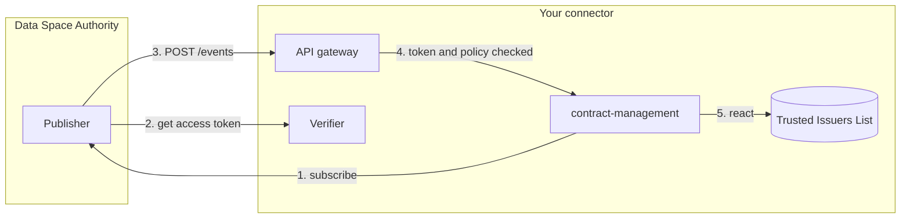

# Data Space Eventing — Participant Setup

A participant of a data space decides whom it trusts: its Trusted Issuers List (TIL) names the
issuers whose credentials it accepts. Until now, nothing told a participant when the data space
removed one of its members, so its TIL kept trusting the removed organization. **Data space
eventing** closes that gap: the data space sends events to its participants, and the Data Space
Connector reacts to them.

This guide covers the participant side: how your connector receives the data space's events and
what it does with them. The publisher at the trust anchor is covered by the
[trust anchor setup](trust-anchor-setup.md), the local demo and the integration test by
[EVENTING.md](../EVENTING.md). The mechanism itself is described in [how it works](architecture.md)
and the [interoperability specification](specification.md); why the chart packages it the way it does
is recorded in [ADR 0008](../adr/0008-events-routes-as-validated-operator-snippet.md).

The feature is off by default. An upgrade with default values creates no eventing ConfigMap, route,
env entry or volume.

<!-- START doctoc generated TOC please keep comment here to allow auto update -->
<!-- DON'T EDIT THIS SECTION, INSTEAD RE-RUN doctoc TO UPDATE -->

- [The use case](#the-use-case)
- [How it works](#how-it-works)
  - [Reacting to a removed participant](#reacting-to-a-removed-participant)
  - [Which trust comes from the membership](#which-trust-comes-from-the-membership)
  - [Who may send events](#who-may-send-events)
- [Enabling](#enabling)
  - [Requirements](#requirements)
  - [1. Configure contract-management](#1-configure-contract-management)
    - [The subscriber's credential](#the-subscribers-credential)
  - [2. Expose the events endpoint at the gateway](#2-expose-the-events-endpoint-at-the-gateway)
  - [3. Register the verifier service](#3-register-the-verifier-service)
  - [4. Create the ODRL policy](#4-create-the-odrl-policy)
  - [5. Test the setup](#5-test-the-setup)
- [Configuration details](#configuration-details)
  - [When configuration changes take effect](#when-configuration-changes-take-effect)
  - [Reconciliation](#reconciliation)
  - [Subscriptions and publisher restarts](#subscriptions-and-publisher-restarts)
  - [What the chart checks on the routes](#what-the-chart-checks-on-the-routes)
  - [Own gateway, and switching the checks off](#own-gateway-and-switching-the-checks-off)
  - [Why the routes look like this](#why-the-routes-look-like-this)
  - [Changing or removing the routes](#changing-or-removing-the-routes)
  - [Management port 9090](#management-port-9090)

<!-- END doctoc generated TOC please keep comment here to allow auto update -->

## The use case

In the example data space of this repository, the **Data Space Authority**
(`did:web:dataspace-authority.org`) keeps the list of the data space's members, the Trusted Issuers
Registry (TIR). `mp-operations.org` and `fancy-marketplace.biz` are members. Because
`fancy-marketplace.biz` is a member, `mp-operations.org` also trusts it as an issuer in its own TIL.

Now the authority removes `fancy-marketplace.biz` from the data space. With data space eventing:

* the authority publishes a *participant removed* event for `fancy-marketplace.biz`;
* the connector of `mp-operations.org` receives it and checks that it really comes from the
  authority;
* it then reports the removal, or revokes the trust that the membership granted, as its operator has
  configured.

Trust that `mp-operations.org` granted for other reasons, for example because
`fancy-marketplace.biz` bought one of its products, is kept unless the operator chooses otherwise.

The mechanism is generic: any entity of the data space can publish events to the participants that
subscribed. The connector currently reacts to one event type,
`org.fiware.dataspace.participant.removed`
([specification §4.1](specification.md#41-orgfiwaredataspaceparticipantremoved)).

## How it works



1. **Subscribe.** contract-management subscribes at the publishers you configure. It announces the
   URL it receives events on, the *sink* (for example `https://events.example.org/events`). The
   publisher confirms the sink with a short handshake.
2. **Authenticate.** To deliver an event, the publisher gets an access token from your verifier by
   presenting its verifiable credential, the same way any other service of the data space is called.
3. **Deliver.** The publisher sends the event to the sink.
4. **Check.** Your API gateway verifies the token and applies an ODRL policy that only lets the
   publisher's credential through. contract-management then checks that the event comes from a
   configured publisher, for an event type that publisher may send.
5. **React.** For a removed participant, contract-management applies the configured reaction.

### Reacting to a removed participant

The reaction is configured per publisher (`on-participant-removed.mode`):

| Mode | What happens |
|---|---|
| `report` | Nothing changes. The removal is recorded and listed at `GET :9090/participants-removed`. Start with this mode. |
| `dataspace` | Revokes the TIL grants that the membership in this data space created. |
| `granted` | As `dataspace`, plus every grant that a product order created for that organization. |
| `full` | Removes the organization from the TIL entirely, including grants from other data spaces and grants made by hand. |

### Which trust comes from the membership

The connector only revokes what it can attribute to the data space. The trusted issuers that the
chart registers through `registration.issuer` are therefore marked as membership grants of the data
space publisher (`scope` = the publisher's id, `scopeType` = `dataspace-membership`), as soon as one
configured publisher sends `participant.removed` events. Without such a publisher nothing changes.
Why trust is attributed this way is recorded in
[ADR 0012](../adr/0012-attribute-local-trust-to-the-dataspace.md).

- Set `scope` on an issuer entry, or `scope: ""` to leave it unmarked, when the default is wrong:
  - the grant does not come from the data space membership (for example an eIDAS `UserCredential`
    issuer, which a removal of that DID would otherwise revoke, or the publisher's own issuer of
    [step 3](#3-register-the-verifier-service));
  - the grant goes to a TIL whose contract-management subscribes to another publisher.
- With several publishers of `participant.removed` events, set `scope` on every entry; the chart
  refuses to guess.
- Issuers registered before this feature stay unmarked (the TIL keeps the existing entry).
  `on-participant-removed.adopt-unattributed` lets contract-management attribute them.
- The marking needs TIL ≥ 0.10.1. An older TIL accepts the request and silently drops the mark.
  The reactions need a newer TIL still, see [Requirements](#requirements).

### Who may send events

contract-management does not verify tokens itself; it relies on the gateway. Three lines of defence
make sure only the publisher gets through:

1. the **verifier** only accepts the publisher's credential, from the issuers you trust for it
   ([step 3](#3-register-the-verifier-service)). That trust also applies to your other services
   that accept the same credential type;
2. the **ODRL policy** at the gateway only admits that credential on `POST /events`
   ([step 4](#4-create-the-odrl-policy));
3. **contract-management** compares the authenticated caller, passed on by the gateway, with the
   publisher id and the event's sender
   ([specification §6](specification.md#6-authorization-rule),
   [ADR 0011](../adr/0011-authorize-events-per-publisher-and-type.md)).

Two requests on the sink are unauthenticated by design: the subscription handshake and the lookup of
where to get a token. Because the gateway configuration carries part of the security, the chart
checks it on install and upgrade ([details](#what-the-chart-checks-on-the-routes)).

## Enabling

Four pieces have to be set up: contract-management, the gateway routes, a verifier service and an
ODRL policy.

### Requirements

- contract-management ≥ 3.5.4: the chart ships it (CM chart 3.6.7) since 10.16.0. 3.5.3 sends the
  scope type by its Java enum name (`scopeType=DATASPACE_MEMBERSHIP`), which the TIL refuses with
  `400`: it then reports removals without `held`, runs no reconciliation and cannot use the writing
  modes.
- TIL ≥ 0.10.3: the chart ships 0.10.3 (decentralizedIam 2.3.0) since 10.16.0. A TIL outside the
  release (`registration.til`) must be upgraded by its operator. Each part of the feature needs:
  - 0.10.1 for the membership marking; an older TIL silently drops it;
  - 0.10.2 for the `dataspace`, `granted` and `full` reactions and for a complete `report`. With an
    older TIL, contract-management fails to start in a writing mode; in `report` mode it runs
    degraded (health `DEGRADED`) and reports removals without what the participant holds;
  - 0.10.3 for `adopt-unattributed`; with an older TIL, contract-management fails to start.
- The bundled APISIX gateway, or an own gateway (see
  [Own gateway](#own-gateway-and-switching-the-checks-off)).

### 1. Configure contract-management

The configuration lives under `contract-management.dataspace.events` and is handed to
contract-management as it is, so its keys are kebab-case. The
[contract-management README](https://github.com/FIWARE/contract-management) documents every key. A
participant that subscribes at the data space authority and only reports removals:

```yaml
contract-management:
  dataspace:
    events:
      # receive events
      listener:
        enabled: true
      # subscribe at the publishers below
      subscriber:
        enabled: true
        # public URL of your POST /events; its host is the host of the gateway routes (step 2)
        sink: "https://events.example.org/events"
        protocol-settings:
          # the verifier service of step 3; publishers request their token for it
          client-id: "<events-service>"
          scopes: [ "default" ]
      publishers:
        - id: "did:web:dataspace-authority.org"
          # the publisher's DNS name, as it announces itself in the handshake
          origin: "cm.dataspace-authority.org"
          types: [ "org.fiware.dataspace.participant.removed" ]
          subscriptions-url: "https://cm.dataspace-authority.org/subscriptions"
          # how contract-management authenticates at the publisher
          client-id: "contract-management"
          scopes: [ "default" ]
          on-participant-removed:
            mode: report
            registry-url: "https://tir.dataspace-authority.org"
```

Read `GET :9090/participants-removed` for a while before switching to a mode that changes the TIL.
Do not leave `dataspace:` empty (null): the contract-management chart then fails the render; remove
the key instead.

`subscriber.protocol-settings.client-id` is required: contract-management does not start without it
when the subscriber is on. `registry-url` is required for every mode but `report`; the
[reconciliation](#reconciliation) sweep compares with it as well.

#### The subscriber's credential

To subscribe, contract-management gets a token from the publisher's verifier (the publisher's
`client-id` and `scopes`) by presenting a credential over OID4VP. The k3s publisher admits a
MembershipCredential whose issuer is a member at the TIR, and identifies the subscriber by that
issuer ([trust anchor setup](trust-anchor-setup.md#who-a-subscriber-is)). Configure CM's OID4VP
holder with your DID and key, and mount the credential into `credentialsFolder`:

```yaml
contract-management:
  oid4vp:
    enabled: true
    credentialsFolder: /credential-repo
    trustAnchors:
      - /etc/ssl/cacert.pem
    holder:
      holderId: "did:web:mp-operations.org"
      keyType: EC
      # a PKCS#8 key
      keyPath: /signing-key/tls.key
      signatureAlgorithm: ECDH-ES
```

The chart has no value for the key or the credential; mount them with
`contract-management.deployment.additionalVolumes` and `additionalVolumeMounts`.
[`k3s/eventing-provider.yaml`](../../k3s/eventing-provider.yaml) shows the full setup, including
the init containers that convert the key and import the cluster CA.
[`k3s/eventing-consumer.yaml`](../../k3s/eventing-consumer.yaml) adds the MembershipCredential to a
`credentialsFolder` that already holds other credentials.

### 2. Expose the events endpoint at the gateway

The publisher reaches contract-management through your API gateway. Three routes are needed:

| Route `name` | Request | Purpose | Authentication |
|---|---|---|---|
| `dataspace-events` | `POST /events` | event delivery | token and ODRL policy |
| `dataspace-events-handshake` | `OPTIONS /events` | subscription handshake | none |
| `dataspace-events-discovery` | `GET /events/.well-known/openid-configuration` | tells the publisher where to get a token | none |

The chart does not add them for you, because the host and the verifier service depend on your
deployment ([ADR 0008](../adr/0008-events-routes-as-validated-operator-snippet.md)). They are a ready
example, [`examples/events-routes.yaml`](examples/events-routes.yaml):

1. **Append** its three entries to your own `decentralizedIam.odrlAuthorization.apisix.routes` list.
   Helm replaces lists instead of merging them: passing the example with `-f` next to a values file
   that has its own `routes` list keeps only one of the two lists.
2. **Keep the three `name`s.** The chart finds the routes by name to check them; a renamed copy is
   not checked at all.
3. **Bind all three to the host of your sink URL** (`subscriber.sink`), with `host` or `hosts`. Never
   leave the binding empty and never set both; APISIX rejects either.
4. Replace `<events-service>` with the verifier service of [step 3](#3-register-the-verifier-service),
   in `openid-connect` (`discovery` and `client_id`) of `dataspace-events` and in the rewrite `uri`
   of `dataspace-events-discovery`.
5. Change `upstream.nodes` if contract-management is not reachable as `contract-management:8080` or
   the verifier not as `verifier:3000`. Change the `uri` of all three entries if your sink path is not
   `/events`.

Pick as sink host the host whose catch-all route already leads to contract-management (in k3s the
`contract-management` host); see [Why the routes look like this](#why-the-routes-look-like-this).

The routes and `listener.enabled` are two separate switches, and the chart does not check that they
agree: routes without a listener answer `404`; a listener without the routes is fine when you run
your own gateway.

### 3. Register the verifier service

Register the events service at the verifier under
`decentralizedIam.vcAuthentication.vcverifier.registration.services`. Its `id` is the
`<events-service>` of the routes and the subscriber's `protocol-settings.client-id`; its scope is the
one the publishers request (`protocol-settings.scopes`).

The token it issues must carry:

- the claim `participantId` = the publisher's DID: contract-management compares it with the event's
  sender. Take it from the credential's `credentialSubject.id`. If the publisher's credential has no
  subject id, map `issuer` instead. The k3s demo does this: its trust anchor issues its own
  OperatorCredential, without a subject id. This is only safe while your TIL lists the publisher as
  the sole issuer of that credential type;
- the credential's `type` and `issuer` under `verifiableCredential`: the ODRL policy of
  [step 4](#4-create-the-odrl-policy) reads them there.

So map these claims explicitly. `fullInclusion: true`, as on the other k3s services, does not work
here: the verifier then ignores the mapping and the token has no `participantId`.

```yaml
decentralizedIam:
  vcAuthentication:
    vcverifier:
      registration:
        services:
          # ... your other services ...
          - id: <events-service>
            defaultOidcScope: "default"
            authorizationType: "DEEPLINK"
            oidcScopes:
              "default":
                # put the mapped claims at the top level of the token
                flatClaims: true
                credentials:
                  - type: OperatorCredential
                    # trust only the issuer(s) of the publisher's credential
                    trustedParticipantsLists:
                      - https://tir.dataspace-authority.org
                    trustedIssuersLists:
                      - http://trusted-issuers-list:8080
                    jwtInclusion:
                      enabled: true
                      # a "." in newKey creates a nested claim
                      claimsToInclude:
                        - originalKey: credentialSubject.id
                          newKey: participantId
                        - originalKey: type
                          newKey: verifiableCredential.type
                        - originalKey: issuer
                          newKey: verifiableCredential.issuer
                dcql:
                  credentials:
                    - id: operator-query
                      format: "jwt_vc_json"
                      multiple: true
                      meta:
                        type_values:
                          - [OperatorCredential]
```

The k3s demo's mapping (`issuer` → `participantId`) is covered by the integration test
([EVENTING.md](../EVENTING.md#integration-tests)).

The verifier checks the credential's issuer against `trustedIssuersLists`, here this participant's
own TIL. That TIL must therefore list the issuer of the publisher's credential
(`did:web:dataspace-authority.org`) for `OperatorCredential`, or the verifier refuses the credential
and the publisher never gets a token. Add it to your `registration.issuer` list (Helm replaces lists,
so keep your other entries) with `scope: ""`: this trust does not come from the membership, so it
must not carry the membership mark (see
[Which trust comes from the membership](#which-trust-comes-from-the-membership)).

```yaml
registration:
  issuer:
    # ... your other issuers ...
    - did: did:web:dataspace-authority.org
      credentialTypes:
        - OperatorCredential
      scope: ""
```

The registration Job only creates issuers: for a DID the TIL already holds it gets a `409` and changes
nothing, so the snippet only works on a first registration. Two cases need more:

- **The DID is already in `registration.issuer`** (as in `k3s/provider.yaml`): add
  `OperatorCredential` to that entry and set `scope: ""` on it, instead of adding a second entry,
  which would only get the `409`. Without `scope: ""` the entry gets the membership mark as soon as
  a `participant.removed` publisher is configured. If the TIL already holds the DID, the entry keeps
  the scope it was first written with (next case).
- **The DID is already registered in the TIL** (for example by an earlier install): changed
  `credentialTypes` or `scope` values never reach it. Add the type through the TIL API with
  `PUT <til>/issuer/<did>`. It replaces the issuer's unscoped credentials, so send the full list,
  including the ones it already has; credentials granted under a scope are left untouched.

This trust is not limited to the events service. A TIL entry applies to every verifier service that
reads this TIL for `OperatorCredential`. In `k3s/provider.yaml` these are `tmf-api`, `tpp-service`
and the `operator` scope of `data-service`, which all accept the authority's operator credential
(there the entry already exists for `tmf-api`). Only the ODRL policies of those services keep the
authority out, so none of them may admit a request on the credential type alone. To avoid widening the trust at all, let the publisher present a dedicated
credential type and register the authority for that type only (see [step 4](#4-create-the-odrl-policy)).

### 4. Create the ODRL policy

[`allowDataSpaceEvents.json`](../../it/src/test/resources/policies/allowDataSpaceEvents.json) is an
example policy for the events path; create it at the ODRL-PAP (`POST <odrl-pap>/policy`). It admits
`POST` on `/events` for an `OperatorCredential` **issued** by `did:web:dataspace-authority.org`, the
k3s authority that issues the publisher's credential to itself.

- **Change the issuer DID.** Every participant's Keycloak issues `OperatorCredential`, so the type
  alone would admit any participant's operator. Set the DID that issues the publisher's credential
  (the publisher's own id only when it issues its credential itself), or use a dedicated credential
  type. A wrong DID rejects every delivery with `403`.
- **The issuer must be a plain string** in the credential. An issuer object (`{"id": "did:..."}`,
  allowed by the VC data model) never matches, and every delivery gets `403`.
- The policy checks who issued the credential; contract-management checks who holds it.

### 5. Test the setup

The chart refuses route settings that weaken access control
([details](#what-the-chart-checks-on-the-routes)). Mistakes that only break the flow are not checked,
so go through this list once:

- [ ] All three routes are in the list.
- [ ] `dataspace-events` has `methods: [POST]`. Without it the route may hide the handshake, which
      then answers `401`.
- [ ] The handshake `uri` equals the events `uri`; the discovery `uri` is the events `uri` +
      `/.well-known/openid-configuration`.
- [ ] All three routes bind the same hosts, and the sink URL's host is one of them.
- [ ] The discovery route's rewrite `uri` is `/services/<id>/.well-known/openid-configuration` for
      the same verifier service as the `discovery` URL of `dataspace-events`.
- [ ] `contract-management.dataspace.events.listener.enabled: true` when contract-management runs in
      this release.

Then test from outside the cluster:

```shell
# handshake: 2xx, and WebHook-Allowed-Origin for a configured publisher origin
curl -i -X OPTIONS https://events.example.org/events -H 'WebHook-Request-Origin: cm.dataspace-authority.org'
# delivery without a token: 401
curl -i -X POST https://events.example.org/events -H 'Content-Type: application/cloudevents+json' -d '{}'
# discovery: the events service's metadata, with the scope the publishers request
curl -s https://events.example.org/events/.well-known/openid-configuration
```

and let the publisher deliver one event. A wrong item shows up at once: the subscription stays
inactive (handshake), the publisher logs that it cannot get a token (discovery), or the delivery is
answered `401`/`403` (token or policy).

## Configuration details

### When configuration changes take effect

The chart puts `contract-management.dataspace.events` into a ConfigMap of its own, which
contract-management watches.

| Keys | Takes effect |
|---|---|
| `listener.enabled`, `subscriber.enabled`, `publisher.enabled`, `tir-watcher.enabled`, `listener.watch.*`, `publisher.sink-connect-timeout`, `publisher.sink-read-timeout` | at startup. Changing one restarts contract-management. |
| everything else, `publishers` included | at runtime, within about a minute, without a restart. |

### Reconciliation

Events can be missed: the publisher was down, the subscription had lapsed, the delivery failed. The
reconciliation sweep is the backstop: it compares the grants this participant holds for each
publisher with the publisher's registry (`on-participant-removed.registry-url`) and applies the
configured mode to every DID that is no longer listed. Its outcome appears in
`GET :9090/participants-removed` with `trigger: reconciliation`; an event's outcome has
`trigger: event`.

The sweep is configured once for all publishers, not per publisher:

```yaml
contract-management:
  dataspace:
    events:
      participant-removed:
        reconcile:
          # first sweep after start-up, then every interval
          initial-delay: PT1M
          interval: PT15M
```

The values shown are CM's defaults. There is no endpoint that triggers a sweep; a restart runs one
after `initial-delay`. The k3s files set `interval: PT6H`, so the integration test sees the sweep
only right after a restart.

### Subscriptions and publisher restarts

A subscription lives for the publisher's lease (CM default `PT24H`). The subscriber renews it after
`subscriber.renewal-fraction` (default 0.5) of the remaining lease, and retries a failed
registration from `subscriber.retry.initial-backoff` (`PT5S`), doubling up to `retry.max-backoff`
(`PT5M`), without limit.

A CM publisher keeps its subscriptions in memory, so its restart drops them, and the subscriber only
re-subscribes at its next renewal. Until then no event reaches it; the [reconciliation](#reconciliation)
sweep closes that gap. The `dataspace-subscriptions` health indicator on port 9090 shows each
publisher's subscription `state` and `expiresAt` (to anonymous callers only with
`ENDPOINTS_HEALTH_DETAILS_VISIBLE=ANONYMOUS` in `additionalEnvVars`, as k3s sets).

### What the chart checks on the routes

`helm install` and `helm upgrade` fail when one of the following does not hold. Each would weaken
access control while events still arrive, so nothing else would show it.

1. The APISIX ingress-controller mode (`apisix.ingress-controller.enabled`) is off. In that mode the
   routes lose their methods and hosts, so the unauthenticated handshake route would accept every
   method on `/events`. Use the default mode or an etcd-backed mode.
2. `dataspace-events-handshake` has exactly `methods: [OPTIONS]`.
3. `dataspace-events-discovery` has exactly `methods: [GET]`.
4. `dataspace-events` is bound to a host (`host` or a non-empty `hosts`).
5. `dataspace-events` has `openid-connect` with `bearer_only: true` (otherwise a request without a
   token passes) and `set_userinfo_header: true` (contract-management reads the caller from the
   `X-Userinfo` header).
6. `dataspace-events` has the `opa` plugin, so the ODRL policy applies.
7. `dataspace-events` removes a client-sent `X-Userinfo` with `proxy-rewrite.headers.remove`, at a
   `proxy-rewrite._meta.priority` above that of `openid-connect` (its `_meta.priority`, default 2599).
8. None of `openid-connect`, `opa` and `proxy-rewrite` on `dataspace-events` is switched off with
   `_meta.disable` or made conditional with `_meta.filter`.
9. `dataspace-events` sets none of `script`, `service_id`, `filter_func`, `vars`, `remote_addrs`,
   `remote_addr`, and no `status` other than `1`. A script replaces the route's plugins, a service can
   bring one in, and the others let `/events` fall through to another route of the host.

### Own gateway, and switching the checks off

The route checks only run when `decentralizedIam` deploys the bundled APISIX gateway, i.e. none of
`decentralizedIam.enabled`, `decentralizedIam.odrlAuthorization.enabled` and
`decentralizedIam.odrlAuthorization.apisix.enabled` is `false`. Check 1 still runs with
`apisix.enabled: false`, because the routes are then still rendered for an ingress controller that
may run outside the release.

An own gateway must reproduce the same three routes and the same protection: host binding, the
unauthenticated handshake, the discovery route, token verification with the claims passed on in
`X-Userinfo`, the ODRL policy, and removing a client-sent `X-Userinfo`.

If the checks refuse a setup that is correct (another authentication chain, an `X-Userinfo` strip in
a global rule, an APISIX upgrade that moves a plugin priority), set
`eventingRouteValidation.enabled: false`. That switches off every check, so verify the list in
[What the chart checks on the routes](#what-the-chart-checks-on-the-routes) by hand.

### Why the routes look like this

- **The host is required.** APISIX tries routes bound to the request's host first and uses host-less
  routes only when none matches. DSC deployments bind their routes to hosts, with `/*` catch-alls, so
  a host-less `/events` would lose to the catch-all of the sink host and run under another verifier
  scope and policy.
- **Use the host whose catch-all already leads to contract-management.** The exact `/events` routes
  then take precedence over it. Any other route that leads to contract-management (a `/*` on another
  host) also forwards `POST /events`, but with its own verifier scope and policy and without the
  `X-Userinfo` strip. Such routes must exclude `/events`: with a `vars` condition, or an ODRL policy
  that denies it.
- **The discovery route.** When the publisher gets a `401`, it looks up where to get a token at
  `<sink>/.well-known/openid-configuration`
  ([specification §5.1](specification.md#51-token-flow-fiware-m2m-profile-of-oid4vp), step 1).
  Without this route it cannot get a token.
- **`discovery` uses the verifier's external URL.** The verifier announces its keys under its
  external host whatever URL its metadata was fetched from, and the gateway checks the token's issuer
  against that metadata. An internal `http://verifier:3000/services/<events-service>/...` URL works as
  well when the gateway reaches the external host. Set `openid-connect.proxy_opts` where the gateway
  needs a proxy for it.
- **The `proxy-rewrite` priority.** APISIX runs a route's plugins by descending priority.
  `openid-connect` (2599) sets `X-Userinfo`; at its default priority (1008) `proxy-rewrite` would run
  afterwards and remove that header again, and contract-management would reject every delivery. With
  `_meta.priority: 2600` it removes a client-sent header *before* `openid-connect` runs. APISIX 3.19.0's
  `openid-connect` already replaces a client-sent `X-Userinfo`, so the strip is defence in depth: it
  keeps holding if a later APISIX stops doing that.

### Changing or removing the routes

- **Default mode** (APISIX `standalone`, routes from a ConfigMap): a changed route takes effect within
  about a minute, without a restart. Removing the entries removes the routes.
- **etcd-backed modes** (`traditional` + etcd, as in `k3s/provider.yaml`): the routes are written to
  APISIX on install and upgrade, under the id `<release>-<index>`, and never deleted. Removing the
  entries, or shortening the list, leaves the trailing routes behind, as for any route removed from
  the list. Delete them through the admin API:

  ```shell
  curl -s http://<release>-apisix-admin:9180/apisix/admin/routes -H "X-API-KEY: $ADMIN_KEY"
  curl -X DELETE http://<release>-apisix-admin:9180/apisix/admin/routes/<release>-<index> -H "X-API-KEY: $ADMIN_KEY"
  ```

  These modes need `decentralizedIam.odrlAuthorization.apisix.etcd.enabled: true` (or an external
  etcd); the render fails otherwise.
- **Ingress-controller mode**: refused by the chart (check 1).

### Management port 9090

contract-management's management port 9090 serves `POST /refresh` (re-reads the configuration) and
`GET /participants-removed` (removal reports) without authentication. It must stay cluster-internal:
no Service port, Ingress or route for it, and a NetworkPolicy where pod IPs are reachable.
`/refresh` is open on every contract-management ≥ 3.5.3, eventing on or off; see the
[10.16.0 release notes](../release-notes/10-x.md#10160--participant-side-of-data-space-eventing) for
the opt-out.
